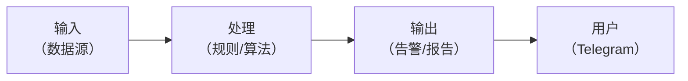
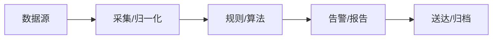
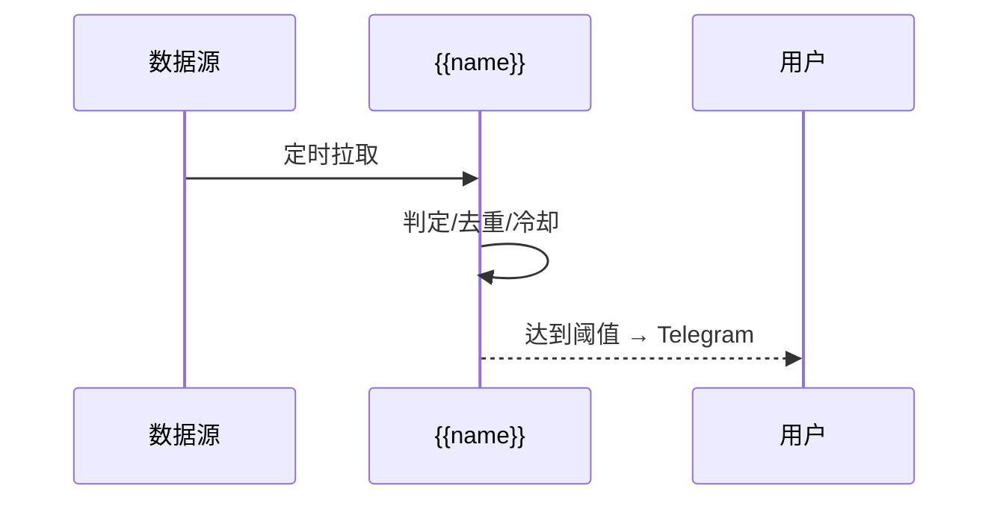

# 业务架构：{{name}} —— {{desc}}

> 需求见 [requirement.md](requirement.md)，实现细节见 [design.md](design.md)。
> 仓库技术架构（分层/调度）见 [../architecture.md](../architecture.md)。

## 1. 业务能力图

## 2. 业务数据流

## 3. 关键流程 / 生命周期

## 4. 与其他模块 / 共享库的关系

| 关系 | 说明 |
|---|---|
| `libs/crypto_core` | 复用（列出用到的能力） |
| 其他需求模块 | 零 import；如需数据只读对方 `data/exports/` |
| 调度 | launchd Label `com.crypto-research.{{name}}` |
