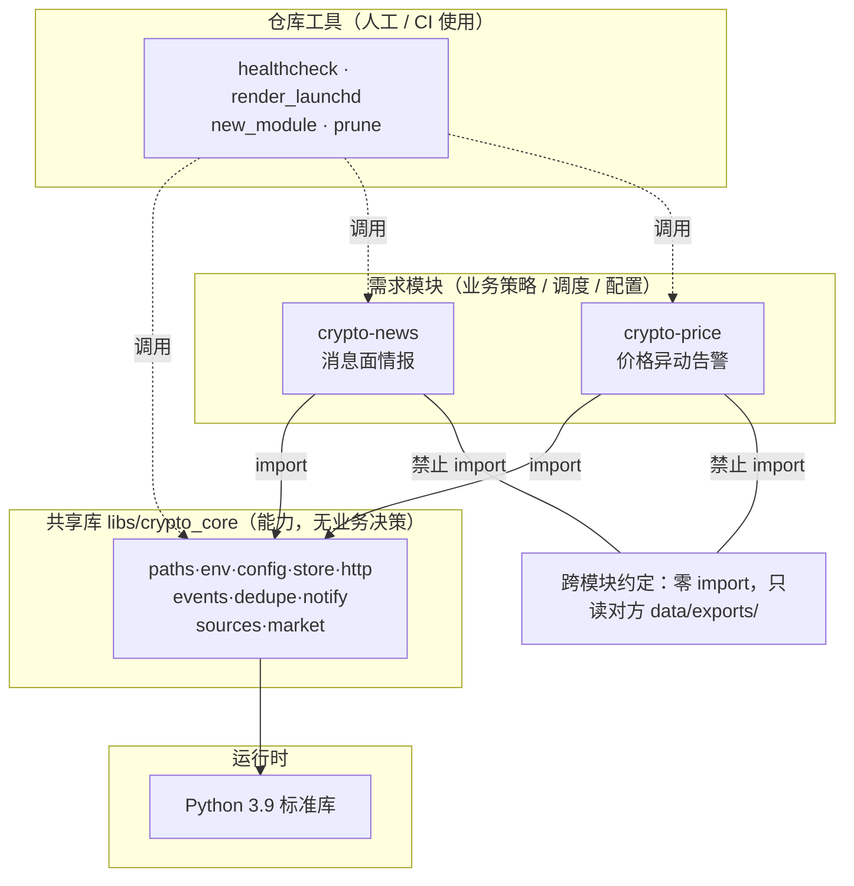
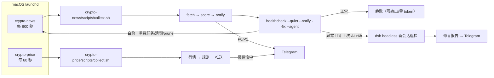
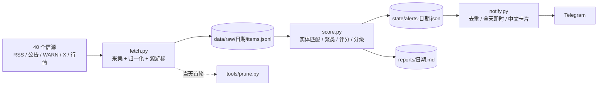
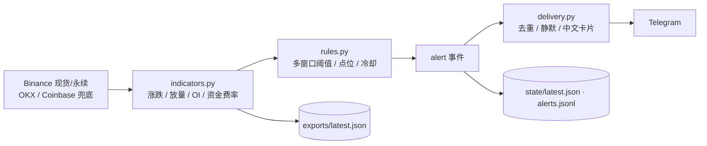
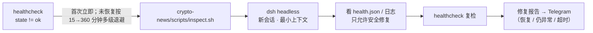

# crypto-research 架构设计 v1（提案）

> 状态：**架构重构 P0–P4 已全部落地**（2026-11-08 03:50，本地时区）｜P4 = `crypto-price/` 价格/衍生品异动告警，验证架构可直接承载新模块
> 定位：这个仓库今后承载**所有 crypto 相关需求**（行情、消息面、链上、宏观、报告、回测……），
> 一个需求一个模块，共性沉到共享库。本文定义目录、分层、共享能力、契约和演进路线。
> 关联：[模块化落地记录](code-plan-module-split.md)、[方案 v0.6](crypto-intel-plan.md)、[HANDOFF](HANDOFF.md)

---

## 0. 摘要（TL;DR）

- **三层结构**：根目录只放共享配置/凭据/文档/CI；`crypto-*/` 是需求模块；`libs/crypto_core` 是共享能力；`tools/` 是仓库级工具。
- **依赖单向**：模块 → libs；**模块之间零 import**，只通过 `data/exports/` 的产物契约交互。
- **共性按"第二个使用者出现才抽"分批下沉**：先 `notify / events / dedupe / store / env`（两个模块都必然要用），再 `http / sources / market`，最后 `report / launchd 生成器 / prune`。
- **统一运行时**：Python 3.9 标准库为主；单根 `.venv`（没有也能跑）；凭据只在根 `.env`。
- **每个模块自带**：README、配置示例、单测、`data/` 产物目录、launchd 模板、离线回放能力。
- **新需求 30 分钟起步**：`docs/_template/` 五件套模板 + `tools/new_module.py` 脚手架（同时生成代码与文档）+ `make verify` + 一键装调度。

---

## 1. 目标与约束

| 类别 | 内容 |
|---|---|
| **目标** | ① 所有 crypto 需求有唯一归属目录，不再往根目录堆文件；② 共性能力只实现一次（推送、事件、去重、抓取、行情、存储）；③ 每个模块可独立运行、独立调度、独立测试；④ 新需求低成本起步；⑤ 可回放、可回滚、可脱离本机迁移 |
| **硬约束** | 个人项目、零付费（无 VPS/无付费 API）；本机 macOS + Python 3.9；launchd 调度；Telegram 送达；凭据不出本机；中文为主 |
| **软约束** | 单文件尽量 < 500 行；模块代码 < 800–1000 行再考虑拆包；不引入数据库/消息队列/微服务 |
| **非目标** | 多用户/权限体系、Web 服务、实时流式处理、分布式部署、PyPI 发包、K8s、复杂 CI 矩阵 |

---

## 2. 关键决策（ADR 速览）

| # | 决策 | 结论 | 理由 |
|---|---|---|---|
| D1 | 仓库形态 | **单仓多模块（monorepo）** | 个人项目、共享凭据/工具/文档，拆仓只会增加同步成本 |
| D2 | 模块位置 | **顶层 `crypto-*/`**（不再包一层 `modules/`） | 已有 `crypto-news`，前缀已能自解释；等模块 > 6 个再机械分组，避免反复搬迁 |
| D3 | 共享代码形态 | **`libs/crypto_core/` 纯 Python 包 + `PYTHONPATH`**，不做 pip 发包 | 零网络、零安装、系统 python3 也能跑；发包/版本管理对个人项目是负担 |
| D4 | 依赖方向 | **模块 → libs 单向；模块之间禁止 import** | 共享能力不依赖业务，业务之间不被耦合；跨模块只走数据契约 |
| D5 | 运行时 | **统一 Python 3.9**；Node 只在某个模块确有硬需求时**模块内自带**，不进 libs | 当前双运行时（Python 情报 + Node 价格）已消失，不再引入第二套 |
| D6 | 环境 | **单根 `.venv`**（仅 ruff/PyYAML 开发增强）；模块脚本无 venv 时回退 `python3` | 避免每个模块重建 venv；零依赖原则下不会有版本冲突 |
| D7 | 数据 | **模块内 `data/`**：`raw/ state/ reports/ exports/ logs/`；跨模块只读 `exports/` | 数据归属清晰、备份/清理简单；不建中央数据库 |
| D8 | 凭据 | **根 `.env` 唯一来源**，`.env.example` 列 key；CI 做"密钥/数据未入库"检查 | 一处维护，入库风险最小 |
| D9 | 事件与告警 | **统一 `alert/v1` 事件模型**（P0/P1/P2、去重键、三行摘要、证据链） | 多模块都要推送时不必再造一套严重度词汇 |
| D10 | 调度 | 每模块自带 launchd 模板，`tools/render_launchd.py` 统一渲染；Label = `com.crypto-research.<module>` | 安装/卸载/日志路径一致，旧任务可自动清理 |
| D11 | 测试 | libs 纯单测 + 模块规则单测 + **离线 fixtures 全链路**（CI 不联网） | 抓取类代码必须可离线复现，否则 CI 不可信 |
| D12 | 文档 | `docs/` 共享层（architecture/runbook/conventions/adr）+ 每需求一个目录 `docs/<module>/`（README/requirement/design/architecture/technical） | 新会话先读 HANDOFF/docs/README 即可接手 |

---

## 3. 目标目录结构

```
crypto-research/                     # 仓库根 = 共享层（不放业务代码）
├── README.md                        # 模块总览 + 结构图 + 约定 + 快速开始
├── pyproject.toml / Makefile        # ruff 全仓配置 + setup/lint/test/verify/launchd/prune
├── env.example / .env               # 凭据模板 / 真实凭据（gitignored）
├── .github/workflows/ci.yml         # hygiene + lint + libs + 各模块测试（全离线）
├── .vscode/                         # 解释器、extraPaths、调试配置
│
├── docs/
│   ├── architecture.md              # 本文：结构图 / 分层 / 共享能力 / 契约 / 演进
│   ├── runbook.md                   # 运行与下线：调度机制、暂停/卸载、健康检查、故障排查
│   ├── conventions.md               # 命名/配置/数据/日志/CLI/退出码规范
│   ├── adr/                         # 架构决策记录 0001-0007
│   ├── README.md                    # 文档导航（共享层 vs 各需求目录）
│   ├── _template/                   # 新需求文档模板（五件套）
│   ├── crypto-news/                 # 需求文档：README/requirement/design/architecture/technical
│   ├── crypto-price/                # 需求文档：同上
│   ├── crypto-intel-plan.md         # 消息面方案 v0.6
│   ├── code-plan-module-split.md    # 模块化落地记录（历史）
│   ├── HANDOFF.md / day1-setup.md / history/
│
├── libs/                            # ── 共享能力（无调度、无业务决策）──
│   └── crypto_core/
│       ├── README.md
│       ├── src/crypto_core/
│       │   ├── paths.py env.py config.py timeutil.py store.py text.py http.py
│       │   ├── events.py            # alert/v1 事件模型 + 分级 + 去重键
│       │   ├── dedupe.py            # DailyKeys / Cooldown
│       │   ├── notify/              # telegram.py 发送 + templates.py 中文卡片
│       │   ├── sources/             # rss / announcements / telegram（预览页·页面指纹）
│       │   └── market/              # binance / okx / coinbase / defillama 解析
│       └── tests/                   # 72 项纯单测（离线）
│
├── tools/                           # ── 仓库级工具（不被模块 import）──
│   ├── healthcheck.py               # 运行期自检/诊断/自愈/按需 AI 分析
│   ├── render_launchd.py            # plist 渲染/安装/状态/卸载（agent/healthcheck/inspect）
│   ├── new_module.py                # 新模块脚手架
│   ├── prune.py                     # 数据保留 + 总量兜底
│   ├── agents/inspect-prompt.md     # headless 巡检任务卡
│   └── tests/                       # 工具单测（17 项）
│
├── crypto-news/                     # ── 模块 1：消息面情报采集/评分/告警（10 分钟）──
│   ├── scripts/
│   │   ├── fetch.py score.py notify.py common.py   # 采集/评分/推送/适配层
│   │   ├── run.sh collect.sh verify.sh install_launchd.sh
│   │   └── inspect.sh                              # 被 healthcheck 调用 → dsh headless
│   ├── config/*.yaml                # 7 个配置（信源/实体/阈值/送达…）
│   ├── tests/                       # 46 项单测
│   ├── deploy/launchd/              # agent / healthcheck / inspect 三个模板
│   └── data/                        # raw/ state/ reports/ exports/ logs/（gitignored）
│
├── crypto-price/                    # ── 模块 2：价格/衍生品异动实时告警（60 秒）──
│   ├── scripts/                     # run.py + sources/indicators/rules/delivery/cards/report
│   ├── config/                      # app / rules / watchlist
│   ├── tests/                       # 154 项单测（含红队用例）
│   ├── deploy/launchd/agent.plist.tmpl
│   └── data/                        # state/ reports/ exports/ logs/
│
└── crypto-<next>/                   # 后续需求：链上、宏观、报告、回测…按同约定新增

```

> **当前实现状态（2026-11-08 12:50）**：P0–P4 全部落地；2 个模块（crypto-news / crypto-price）共用 libs、互不 import；
> 运行期 8 个 launchd 任务（news 10min / price 60s / kol 5min / policy 6h+08:30 / analyst 日报10:00 + 周报周日20:00）；原 crypto-report 与 20:05 DSH AI 复盘已退役（2026-11-08 收口到 crypto-analyst）。全仓 `make gate` 15 步全绿。

**为什么模块放顶层、不加 `modules/`**：当前只有 2 个模块，`crypto-` 前缀已能与 `libs/`、`tools/`、`docs/` 区分；多一层会拉长所有路径与命令。**触发条件**：模块数 > 6 或出现非 `crypto-` 前缀的模块时，再一次性 `git mv modules/`，届时提供迁移脚本（机械操作，风险低）。

---

## 3.1 结构图

### 图 1：分层与依赖



### 图 2：运行架构（2 个 launchd 任务 + 按需 AI）



### 图 3：crypto-news 数据流（消息面）



### 图 4：crypto-price 数据流（行情异动）



### 图 5：健康检查 → AI 按需链路



## 4. 分层与依赖规则

```
        ┌──────────────────────────────┐
        │  crypto-*  （需求模块）       │  业务策略 / 调度 / CLI / 配置
        └──────────────┬───────────────┘
                       │ import（只向下）
        ┌──────────────▼───────────────┐
        │  libs/crypto_core             │  共享能力（无业务决策、无调度）
        └──────────────┬───────────────┘
                       │ 只用标准库
        ┌──────────────▼───────────────┐
        │  Python 3.9 标准库            │
        └──────────────────────────────┘

  tools/ ── 调用 libs 与模块（手工/CI 使用），不被任何模块 import
  crypto-A ──X──> crypto-B（禁止 import；只能读 B 的 data/exports/ 契约文件）
```

| 层 | 可以做什么 | 不可以做什么 |
|---|---|---|
| `crypto-*` 模块 | 读配置、调度、决定阈值/评分/路由、写自己 `data/` | import 其他模块；把共享逻辑再抄一份 |
| `libs/crypto_core` | 通用 I/O 原语、事件模型、推送、行情客户端、存储 | 读 `sys.argv` 做业务决策；启动调度；依赖具体模块的配置字段；写死阈值 |
| `tools/` | 脚手架、调度渲染、数据清理、体检 | 被模块 import；持有业务状态 |

**红线四条**：① 模块间零 import；② libs 不 import 模块；③ 凭据不进代码/配置/仓库；④ 运行产物不进 git。

---

## 5. 共性抽取（核心）

### 5.1 抽取原则

1. **第二个使用者出现才抽**（Rule of Two）：只有一个模块用的逻辑，留在模块里；设计好接缝，等第二个模块要用时再下沉。
2. **抽"能力"不抽"策略"**：`Telegram 发送 + 去重 + 静默`是能力；"哪些事件算 P0、阈值多少"是策略，留在模块配置。
3. **显式传参**：libs 函数不隐式读全局状态；需要配置就由调用方传入。
4. **抽取必须带测试**：先写 libs 测试 + 迁移后的模块测试保持绿，再删旧实现；单步可回滚。

### 5.2 抽取清单

| 能力 | 现状（crypto-news） | 目标位置 | 首个使用方 | 阶段 |
|---|---|---|---|---|
| 仓库/模块路径定位 | `common.ROOT/DATA_DIR` | `libs: paths.py` | 全部 | **P0** |
| 根 `.env` 读取 | `notify.load_env` | `libs: env.py` | 全部 | **P0** |
| YAML/JSON 配置加载 | `common.load_config`（含 Ruby 兜底） | `libs: config.py` | 全部 | **P0** |
| JSONL/JSON 原子写 + 状态 | `common.safe_json_dump` | `libs: store.py` | crypto-news / crypto-price | **P0** |
| 事件模型 + 分级 + 去重键 | `score` 内联 + `notify.event_key` | `libs: events.py` | crypto-news / crypto-price | **P0** |
| 24h 去重 / 冷却 | `notify` 内联（`notified.json`） | `libs: dedupe.py` | crypto-news / crypto-price | **P0** |
| Telegram 推送（分片/退避/静默/模板/dry-run/test/discover） | `notify.py`（307 行，已完成度高） | `libs: notify/` | crypto-news / crypto-price | **P0** |
| 时区/静默配置/衰减窗口 | `notify.in_quiet_hours`、`score.decay_hours` | `libs: timeutil.py` | 全部 | **P0** |
| 统一 HTTP（UA/超时/重试/限速） | `fetch.http_get` | `libs: http.py` | crypto-news / 后续所有抓取 | P1 |
| RSS/Atom 解析 | `fetch.parse_rss` | `libs: sources/rss.py` | crypto-news / 宏观日历 | P1 |
| 网页 diff（无 RSS 公告页） | `fetch.collect_html` | `libs: sources/http_diff.py` | crypto-news / 链上 | P1 |
| r.jina.ai 代理（X/被墙页） | `fetch.collect_jina` | `libs: sources/jina.py` | crypto-news / KOL 追踪 | P1 |
| Binance 行情/资金费率客户端 | `fetch.collect_market` | `libs: market/binance.py` | crypto-news / crypto-price | P1 |
| DefiLlama（稳定币/TVL/价格） | `fetch.collect_market` | `libs: market/defillama.py` | crypto-news / crypto-onchain | P1 |
| Markdown 报告渲染 | `score` 内联 | `libs: report.py` | crypto-news / crypto-analyst | P2 |
| launchd 渲染/安装/卸载 | `crypto-news/scripts/install_launchd.sh` | `tools/render_launchd.py` | 全部 | **P1** |
| 数据保留/清理 | 无 | `tools/prune.py`（已落地，模块每日自动执行） | 全部 | P3 ✅ |
| 信源体检 | 无（已删除的旧工具能力） | `tools/source_health.py` | 全部 | P2 |
| 评分/聚类算法（simhash、金额解析、实体词典） | `score.py` / `fetch.extract_amount_usd` | **暂不抽** | 仅 crypto-news | 出现第二个评分模块再抽 |
| 具体阈值/权重/路由规则 | `config/*.yaml` | **不抽**（模块私有） | — | — |

### 5.3 模块 × 能力矩阵（验证设计是否够用）

| 未来模块 | 用途 | 需要的共享能力 |
|---|---|---|
| `crypto-news`（已有） | 消息面采集/评分/告警 | env, config, store, events, dedupe, notify, http, sources.*, market.* |
| `crypto-price`（已落地） | 价格/衍生品异动告警 | market.binance·okx·coinbase, http, events, notify, store, timeutil, launchd |
| `crypto-onchain` | 巨鲸/稳定币/TVL/交易所储备异动 | market.defillama, http, events, dedupe, notify |
| `crypto-macro` | 宏观日历（FOMC/CPI/非农）、日历提醒 | http, sources.rss, config, events, notify |
| `crypto-analyst` | 日报/周报汇总（读各模块 exports） | report, store, events, config |
| `crypto-backtest` | 评分/阈值回测与校准 | store, timeutil, （只读 raw 数据） |

> 结论：`events + dedupe + notify + store + http + market/sources` 这 6 类能覆盖 90% 的未来需求；
> 评分、策略、阈值这类"每个需求都不同"的部分留在模块内，不强行抽象。

---

## 6. `libs/crypto_core` 设计要点

### 6.1 包结构

```
libs/crypto_core/
├── pyproject.toml            # 仅声明包元数据（不做发布，供编辑器/未来打包用）
├── src/crypto_core/
│   ├── __init__.py           # __version__ = "0.1.0"；显式导出稳定 API
│   ├── paths.py  env.py  config.py  timeutil.py
│   ├── http.py  text.py  store.py
│   ├── events.py  dedupe.py
│   ├── notify/{__init__,telegram,templates}.py
│   ├── market/{__init__,binance,defillama}.py
│   ├── sources/{__init__,rss,http_diff,jina}.py
│   └── report.py
└── tests/
```

### 6.2 使用方式（零安装）

不做 pip 安装。两种接法，效果等价：

**A. 模块入口自探测仓库根**（crypto-news 采用；launchd、直接 `python scripts/x.py` 都能跑）：

```python
import os, sys
_ROOT = os.path.dirname(os.path.dirname(os.path.abspath(__file__)))   # <module>/
_LIBS = os.path.join(os.path.dirname(_ROOT), "libs", "crypto_core", "src")
if _LIBS not in sys.path:
    sys.path.insert(0, _LIBS)
```

**B. `PYTHONPATH`**（libs 自己的单测 / CI / make）：

```bash
PYTHONPATH=libs/crypto_core/src python -m unittest discover -s libs/crypto_core/tests
# 脚本里：
REPO_ROOT="$(cd "$(dirname "$0")/../.." && pwd)"
export PYTHONPATH="$REPO_ROOT/libs/crypto_core/src${PYTHONPATH:+:$PYTHONPATH}"
"${REPO_ROOT}/.venv/bin/python" scripts/fetch.py    # 没 venv 就回退 python3
```

```python
# 模块内使用（P1 已有能力）
from crypto_core import events, notify
alert = events.Alert(module="crypto-price", severity="P0", category="price", title="BTC -1.5%")
text = notify.format_alert(alert.to_dict())        # 渲染
# notify.send_message(token, chat_id, text)        # token 由模块自己从 env 读取后传入
```

### 6.3 API 草案（关键三个）

```python
# events.py —— 统一事件模型（详见 §8.4）
@dataclass
class Alert:
    module: str; severity: str          # P0 | P1 | P2
    category: str; assets: list[str]
    title: str; detail: list[str]
    urls: list[str] = ()
    dedupe_key: str = ""                # 缺省由 category+assets+title 生成
    score: dict | None = None
    summary: dict | None = None         # {"fact":..., "why":..., "action":...}
    ts: str = ""                        # 缺省 now(本地时区)
    schema: str = "alert/v1"
```

```python
# dedupe.py —— 去重与冷却（状态存模块自己的 data/state）
seen = dedupe.SeenStore(path=store_dir / "seen.json", ttl_hours=24 * 7)
if seen.first_seen(alert.dedupe_key):
    cooldown = dedupe.Cooldown(path=store_dir / "cooldown.json", minutes=30)
    if cooldown.allow(alert.dedupe_key):
        notify.send(alert)
```

```python
# notify/telegram.py
notify.send(alert, dry_run=False)          # 读 .env、格式化、发送、记录 delivered
notify.test_message()                      # --test
notify.discover_chat_id()                  # --discover，回写根 .env
```

### 6.4 版本与兼容

- 单仓同步演进，**不发布**；`__version__` 只用于文档与变更记录。
- 破坏性改动必须：改所有调用方 + 更新 `libs/README.md` 的"变更记录" + 在 `docs/adr/` 写一条。
- libs 的 API 只增不减的尽量增；确实要删就同一次提交里全仓改完（CI 会跑所有模块）。

---

## 7. 目录与代码规范

### 7.1 命名

| 对象 | 规范 | 例子 |
|---|---|---|
| 需求模块目录 | `crypto-<topic>`，小写短横线；topic 必须是**领域词**，不要用 `new` / `temp` / `test` 等占位词 | `crypto-news`、`crypto-price`、`crypto-onchain`、`crypto-macro` |
| 模块内脚本 | 动词/名词直白 | `fetch.py`、`score.py`、`collect.sh` |
| 共享能力 | 按子领域分包，单文件单职责 | `notify/telegram.py`、`market/binance.py` |
| 数据文件 | 固定目录语义见 §8 | `data/raw/2026-11-08/items.jsonl` |
| 事件 key | `<domain>:<target>:<event>` | `price:BTCUSDT:newlow`、`news:binance:withdraw_paused` |

### 7.2 代码

- 单文件 < 500 行；模块脚本总量 > 800 行时考虑拆 `src/` + 薄 CLI。
- 只用标准库（PyYAML 允许作为开发增强并带 Ruby 兜底；ruff 只做开发工具）。
- 所有对外副作用（网络、推送、写盘）都要有 `--dry-run` 或可注入的开关。
- 错误处理：单源失败不拖垮整轮（记录并继续），整轮结束汇总退出码。
- 日志：人类可读一行 + 每轮汇总 JSON（`data/state/last_run.json`）。

### 7.3 CLI 约定（所有模块统一）

| 参数 | 含义 | 默认 |
|---|---|---|
| 无参数 | 跑一轮，**不推送**（写产物） | 安全默认 |
| `--once` | 跑一轮后退出（常驻模块用） | — |
| `--dry-run` | 只打印/只写本地，不推送、不产生外部副作用 | — |
| `--test` | 发一条测试消息验证通道 | — |
| `--fixtures <dir>` | 离线回放（CI 专用，禁止联网） | — |
| `--date <YYYY-MM-DD>` | 指定处理日期 | 今天 |
| `--json` | 机器可读输出（给 tools/其他模块） | — |

**退出码**：`0` 成功；`1` 部分源失败但有产出；`2` 配置/凭据错误；`3` 网络全挂；`4` 锁被占用跳过。

### 7.4 配置规范

- 模块配置放 `config/`：YAML（人读、可注释）或 JSON（机器生成）；**必须带** `schema_version: 1`。
- 仓库内提交 `*.example.*` 模板（空凭据）；真实配置若含凭据则 gitignore。
- 阈值/权重/信源清单属于模块私有，**不进 libs**。

### 7.5 数据规范

```
<module>/data/
├── raw/<date>/*.jsonl      # 原始数据（可回放，保留 90 天）
├── state/*.json            # 去重/冷却/游标/锁（有界，自动过期）
├── reports/<date>.md       # 人读产物（长期保留）
├── exports/*.json          # ★ 跨模块只读契约（滚动 7 天）
└── logs/*.log              # 运行日志（保留 30 天）
```

跨模块读取**只允许**读 `exports/`，禁止读别人的 `state/`、`raw/`、`reports/`。
清理统一交给 `tools/prune.py`（支持 `--dry-run`）。

### 7.6 调度规范

- Label：`com.crypto-research.<module>`；旧 Label 由渲染器自动清理。
- 模板：`<module>/deploy/launchd/agent.plist.tmpl`，占位符 `__MODULE_DIR__`、`__LABEL__`。
- 日志：`data/logs/launchd.out.log` / `launchd.err.log`。
- 常驻型模块（价格告警）用 `KeepAlive`；巡检型（情报采集）用 `StartInterval`；同一模块**单实例锁**写在 `data/state/*.pid`。

---

## 8. 契约

### 8.1 统一告警事件 `alert/v1`

```json
{
  "schema": "alert/v1",
  "module": "crypto-price",
  "event_id": "sha256(module + dedupe_key)",
  "ts": "2026-11-08T02:10:00+04:00",
  "severity": "P0",
  "category": "price",
  "assets": ["BTC"],
  "title": "BTC 5m 急跌 1.5%，跌破 76,500",
  "detail": ["现价 76,412（-1.5%）", "24h 低点 76,505 已破"],
  "urls": ["https://www.binance.com/..."],
  "dedupe_key": "price:BTCUSDT:5m_drop",
  "score": {"total": 78.2, "raw": 85.0, "components": {"S": 80, "T": 95, "M": 60, "C": 50, "D": 0.9}},
  "summary": {"fact": "...", "why": "...", "action": "..."},
  "evidence": [{"source_id": "binance_ann", "tier": "T0", "url": "..."}],
  "delivered": [{"channel": "telegram", "ok": true, "ts": "2026-11-08T02:10:01+04:00"}]
}
```

兼容策略：**只增字段不改语义**；现有 `alerts-<date>.json` 的字段（`score/components/hard/confirmed/meta` 等）全部保留，新增 `schema/module/event_id/summary`。

确认度相关字段（P2 起）：`source_tiers`（来源→tier）、`best_tier`、`independent_sources`（不含 T3 的独立源数）、`confirmed`、`unconfirmed`。硬条件升级需过「确认 + 48h 时效 + 衰减 D≥0.1」；T3 聚合站不计独立源。

### 8.2 跨模块导出契约 `exports/<name>.json`

每个模块可导出"只读快照"供别的模块消费，例如：

- `crypto-price/data/exports/latest.json` —— 最新行情快照（给 `crypto-analyst` 写日报用）；
- `crypto-news/data/exports/daily-events.json` —— 当日事件列表（给 `crypto-analyst` 汇总用）。

导出文件必须：带 `schema`、`generated_at`、`source_module`；只增字段；滚动保留 7 天。

### 8.3 日志与运行汇总

- `data/logs/<module>.log`：人类可读（每轮一行）。
- `data/state/last_run.json`：`{started_at, finished_at, rc, counts:{new,alerts}, errors:[...]}`，给 launchd 排查与 `tools/` 汇总用。

---

## 9. 依赖与环境

| 方案 | 说明 | 结论 |
|---|---|---|
| **A. 单根 `.venv` + `PYTHONPATH`**（推荐） | 根 venv 只装 ruff/PyYAML；libs 靠 `PYTHONPATH`；系统 python3 也能跑 | ✅ 零安装、零网络、与现有"无 venv 回退"兼容 |
| B. 每模块独立 venv + `pip install -e libs` | 隔离好，但 2 个 venv 起就要同步维护 | 暂不用；未来某模块需锁不同依赖版本时再切 |
| C. 全走 `PYTHONPATH`、不要 venv | 最轻，但 ruff 等开发工具要全局装 | 作为 fallback 保留 |
| D. 打包发布 PyPI | 个人项目过度设计 | ❌ |

根 `pyproject.toml`（草案）：

```toml
[project]
name = "crypto-research-workspace"
version = "0.0.0"
requires-python = ">=3.9"

[tool.ruff]
line-length = 120
target-version = "py39"
src = ["libs/crypto_core/src", "crypto-news/scripts", "tools"]

[tool.ruff.lint]
select = ["E", "F", "W", "I"]
ignore = ["E501"]
```

根 `Makefile`（草案）：

```makefile
REPO := $(abspath $(dir $(lastword $(MAKEFILE_LIST))))
PY   := $(REPO)/.venv/bin/python
LIBS := $(REPO)/libs/crypto_core/src
MODULES := crypto-news            # 新模块加这里

setup:            ## 建根 venv（可选，没有也能跑）
	python3 -m venv $(REPO)/.venv && $(PY) -m pip install -q pyyaml ruff

verify:           ## 全模块质量门
	$(REPO)/.venv/bin/ruff check libs tools crypto-news/scripts crypto-news/tests
	@PYTHONPATH=$(LIBS) $(PY) -m unittest discover -s libs/crypto_core/tests -v
	@for m in $(MODULES); do echo "== $$m"; PYTHONPATH=$(LIBS) $(PY) -m unittest discover -s $(REPO)/$$m/tests -v; done

new-module:       ## make new-module name=crypto-price desc="价格告警"
	$(PY) tools/new_module.py $(name) --desc "$(desc)"
```

编辑器：`.vscode/settings.json` 加 `"python.analysis.extraPaths": ["libs/crypto_core/src"]`。

---

## 10. 测试与 CI

### 10.1 测试分层（每层都必须离线可跑）

| 层 | 内容 | 工具 |
|---|---|---|
| libs 单测 | 纯函数、解析、事件序列化、去重/冷却、HTTP 重试（打桩） | unittest + fixture |
| 模块规则单测 | 评分/阈值/分级/格式化 | unittest |
| 契约测试 | `alert/v1` 字段、`exports/*.json` 结构、配置 `schema_version` | unittest + golden 文件 |
| 离线全链路 | `--fixtures` 回放一天数据，产出报告/推送内容（不联网、不推送） | unittest 或脚本 |

**硬性规定**：任何模块的 `make verify` 必须能在**断网**下全绿；联网冒烟只做可选步骤（`--with-network`）。

### 10.2 CI

当前实现见 [`.github/workflows/ci.yml`](../.github/workflows/ci.yml)，四个 job：

- `hygiene`：`.env` / `data/` / `.venv/` 不得入库
- `lint`：ruff 检查 libs / tools / 各模块
- `libs`：crypto_core 单测（离线）
- `crypto-news`：模块单测（离线；fixtures 回放 P2 补）

新增模块时：`jobs` 加一个 job + `MODULES` 加一项 + 根 README 模块表加一行（脚手架会打印这三件事）。

---

## 11. 新需求落地 SOP

### 11.1 立项（10 分钟）

在 `docs/<module>/requirement.md` 用固定模板（见 [docs/README.md](README.md)）：

```
# 需求：crypto-price
## 要解决什么问题（一句话）
## 边界：做什么 / 不做什么
## 数据源与频率
## 告警策略（分级、阈值、静默、去重）
## 产物（报告/导出/推送）
## 验收标准（可测量的）
## 依赖的共享能力（libs 哪些 / 需要新增哪些）
```

### 11.2 脚手架

```bash
python3 tools/new_module.py crypto-price --desc "价格与衍生品异动告警"
```

生成：`README.md`、`config/*.example.yaml`、`scripts/run.sh`、`scripts/main.py`（带 `--once/--dry-run/--fixtures` 骨架）、`tests/test_smoke.py`、`deploy/launchd/agent.plist.tmpl`；并打印需要手工改的 3 处（根 README、CI、`.env.example`）。

### 11.3 开发与上线

1. 优先用 libs；发现缺能力 → **先在 libs 加测试和实现**，再在模块里用（不要在模块里抄一份）。
2. `make verify MODULES+=crypto-price` 全绿。
3. 离线 fixtures 跑通 → 联网 `--dry-run` → `--test` 验证推送 → 装 launchd。
4. 观察 24h（误报/漏报/日志），再更新 HANDOFF 与 README。
5. 任何跨模块读写只走 `exports/` 契约。

---

## 12. 演进路线（可回滚）

| 阶段 | 内容 | 产出 | 验收 | 估时 |
|---|---|---|---|---|
| **P0 骨架** | 建 `libs/crypto_core`（paths/env/config/store/timeutil 五个基础件）、根 `pyproject`/`Makefile`、`tools/verify_all.sh`；crypto-news 改用 libs 路径（不动业务） | 目录 + 基础件 + 单测 | `make verify` 全绿；crypto-news 行为不变（25 单测 + 端到端） | 2–3 h |
| **P1 告警共性** | 抽 `events / dedupe / notify`（含模板、静默、退避、discover）；crypto-news 的 `notify.py` 变薄封装；launchd 改由 `tools/render_launchd.py` 渲染 | libs 三个模块 + 迁移后的 crypto-news | 推送内容 golden 测试一致；去重/静默行为不变；`--test/--dry-run` 可验 | 4–6 h |
| **P2 抓取/行情共性** | 抽 `http / sources.* / market.*`；`fetch.py` 拆为模块专属的「源清单 + 适配器」薄层；补离线 fixtures 回放 | libs 抓取与行情能力 | 34 源采集结果与迁移前一致；断网 CI 全绿 | 4–6 h |
| **P3 工具化** | `tools/new_module.py`、`tools/prune.py`；`docs/conventions.md`、`docs/adr/` 落盘；CI 加 hygiene/lint 分 job | 脚手架 + 规范 | 用脚手架生成一个空模块，`make verify` 直接绿 | 3–4 h |
| **P4 首个新模块验证架构** | 按新架构实现 `crypto-price`（价格/衍生品告警），复用 libs 全部能力 | 模块 2 | 独立运行、独立调度、独立测试；与 crypto-news 零耦合 | 1–2 d |

**落地进度（2026-11-08 03:50）**：P0 ✅（libs 基础件 + 根 pyproject/Makefile + 单 venv）、P1 ✅（events/dedupe/notify 抽取，crypto-news/notify.py 变薄封装）、P2 ✅（http/sources/market 下沉，34 源实跑一致）、P3 ✅（new_module/render_launchd/prune + 脚手架实跑验证）、**P4 ✅ crypto-price**（8 类价格/衍生品规则 + 三源核验 + P0/P1/P2 送达治理 + 日报 + launchd 60s + 离线测试；与 crypto-news 零耦合）。

**回滚策略**：每阶段单独提交 + `git tag arch-p0…p4`；libs 抽取采用"先加新实现、模块切换、再删旧代码"三步，任一步失败直接 `git revert` 该提交即可回到上一稳态。**crypto-news 的 25 单测是全程护栏**，任何阶段变红就停下来。

---

## 13. 风险与反模式

| 风险 / 反模式 | 后果 | 对策 |
|---|---|---|
| libs 变成大杂烩 | 谁都不敢改，模块被拖死 | 按子领域分包；单文件 < 500 行；只收"第二个使用者已出现"的能力 |
| 过早抽象 | 一堆没人用的接口 | Rule of Two；模块私有逻辑不抽 |
| 模块互相 import | 改 A 崩 B | 红线：零 import；只读 `exports/` |
| 把业务阈值塞进 libs | 不同模块互相打架 | 阈值/权重/路由永远在模块 `config/` |
| 数据无序膨胀 | 磁盘与备份变重 | `tools/prune.py`：raw 90d / logs 30d / exports 7d；`--dry-run` 先看 |
| 凭据泄露 | Bot/账号被盗 | 根 `.env`；example 空值；CI hygiene job；配置里禁止出现 token |
| 网络依赖导致 CI 不可信 | 测试时红时绿 | 硬性离线 fixtures；联网只做可选冒烟 |
| 单 venv 未来冲突 | 某模块依赖版本不同 | 现在零第三方依赖，风险低；触发时该模块自带 venv（留退路） |
| macOS 休眠/停机 | 定时任务漏跑 | 关键模块（价格类）考虑 VPS/Cloudflare Workers 后路，部署资产放模块 `deploy/` |
| 目录反复搬迁 | 无谓 churn | 顶层 `crypto-*` 定案；只有 > 6 模块才一次性分组 |
| 模块名用占位词（`crypto-new`/`temp`） | 半年后没人知道它是干什么的；改名要动 label/CI/文档 | 立项时就用领域词（`crypto-news`）；脚手架校验名字格式并拒绝占位词 |

---

## 14. 待确认决策

| # | 决策 | 推荐 |
|---|---|---|
| 1 | 模块放顶层 `crypto-*/` 还是 `modules/crypto-*/`？ | **顶层**（当前已如此，避免再搬一次） |
| 2 | 共享库形态：`libs/crypto_core` + `PYTHONPATH`（不发包）？ | **是**（零安装、零网络） |
| 3 | 环境：单根 `.venv`（无 venv 回退 python3）？ | **是**（crypto-news 的 venv 上移到根） |
| 4 | P0/P1 是否立刻执行（先抽 5 个基础件 + 告警三件套）？ | **建议先做 P0–P1**，then 再开 `crypto-price` |
| 5 | `crypto-news` 是否保留现有 `scripts/` 布局（不强制改 `src/`）？ | **保留**，只做"逻辑下沉到 libs"，不做形式重排 |

确认后我按阶段执行；每阶段结束给你可验证的结果（`make verify` 输出 + 变更摘要），再进入下一阶段。
