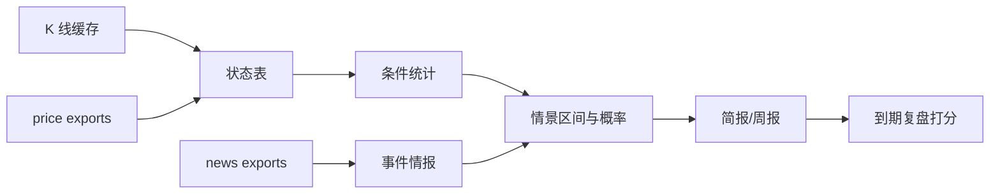

# 业务架构：crypto-analyst —— 行情分析（研究 / 方法验证）

## 0. 一句话定位

把公开行情数据压缩成**可证伪的市场判断**（状态 → 条件统计 → 情景 → 复盘），只做研究与方法验证。

## 1. 业务能力图

## 2. 数据流

1. 取数：Binance 日线（2019-01-01 起）写本地缓存；
2. 计算：`core.py` 纯函数产出状态与条件统计；
3. 成文：`daily_brief.py` / `weekly.py` 输出 Markdown；
4. 复盘：`score.py` 对到期判断打分（记录缺失即空）；
5. 送达：Telegram（脚本或 launchd）。

## 3. 模块关系

- 只读 `crypto-price` / `crypto-news` 的 exports，不反向依赖；
- 不做采集，不重算价格；
- 不保存任何个人资产数据。

## 4. 边界

| 做 | 不做 |
|---|---|
| 公开行情统计、方法验证、情景推演 | 交易/出入金/账户操作指引 |
| 可证伪的输出与复盘 | 日内/杠杆/合约/山寨币 |
| 本地缓存与离线回放 | 付费数据源、个人资产管理 |
