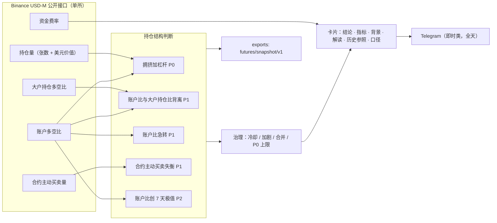
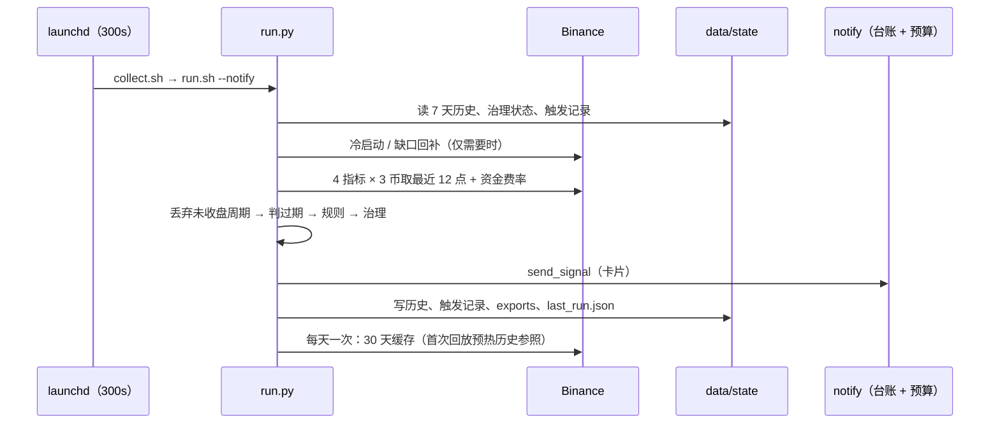
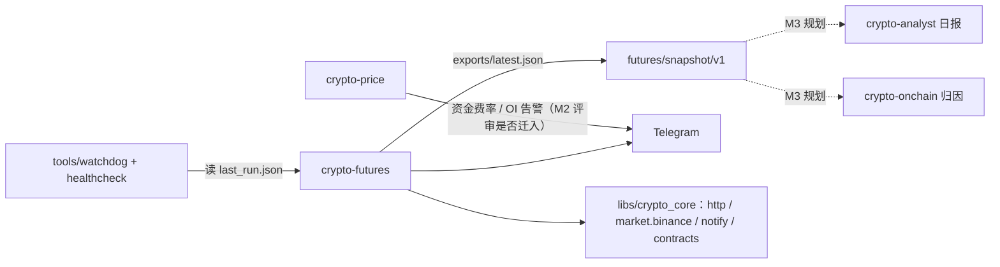

# 业务架构：crypto-futures

> 业务能力、数据流与关键流程。代码层面见 [technical.md](technical.md)。

## 1. 业务能力

## 2. 一轮的数据流

## 3. 与其他模块的关系

- 和 crypto-price 互不 import：资金费率与 OI 由本模块自己取，price 的告警暂不动（M2 再评审）；
- 下游目前没有消费方（`consumers` 为空），exports 先保证字段完整。
