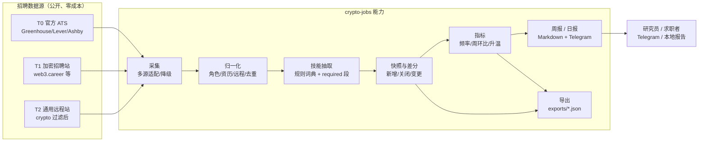
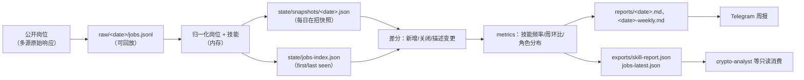
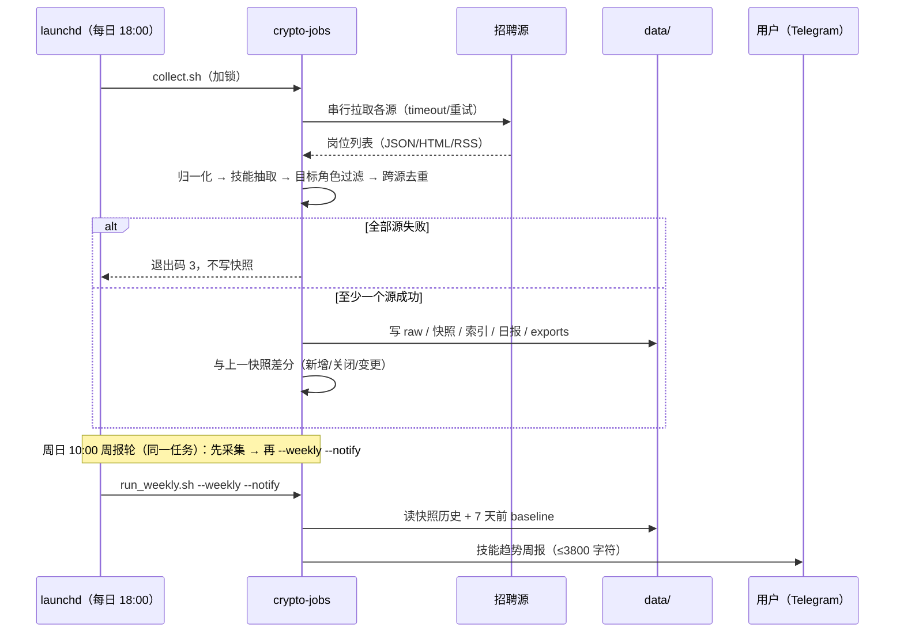
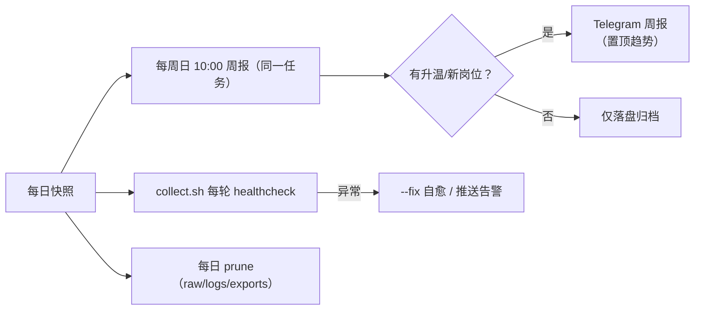

# 业务架构：crypto-jobs —— 加密行业技术岗位市场情报

> 需求见 [requirement.md](requirement.md)，实现细节见 [design.md](design.md)。
> 仓库技术架构（分层/调度）见 [../architecture.md](../architecture.md)。

## 1. 业务能力图

## 2. 业务数据流

## 3. 关键流程 / 生命周期

## 4. 监测闭环

## 5. 与其他模块 / 共享库的关系

| 关系 | 说明 |
|---|---|
| `libs/crypto_core` | 只向下依赖：http / config / store / timeutil / text / env / notify |
| `crypto-news` / `crypto-price` / `crypto-policy` | **零 import**；互不影响 |
| `crypto-analyst` | 只读本模块 `data/exports/skill-report.json`、`jobs-latest.json`（只读契约） |
| `tools/healthcheck.py` | 读 `config/app.yaml` 的 `poll_seconds`、`data/state/last_run.json`、`collect.log` |
| `tools/prune.py` | 每日清理 raw/logs/exports，快照由模块自清理 |

## 6. 角色与场景

| 角色 | 场景 | 用的产物 |
|---|---|---|
| 技术研究者 | 判断哪些技能在加密行业变热 / 变冷 | 周报「技能 Top + 升温」、`skill-report.json` |
| 求职者/开发者（DevOps/SRE/MLOps/开发） | 看市场要求、目标公司、远程比例 | 周报「分角色技能 + 活跃公司 + 新岗位」 |
| 仓库维护者 | 排查源失效、词典漏词 | `source-health`、`raw/`、`last_run.json`、失败源折叠块 |
