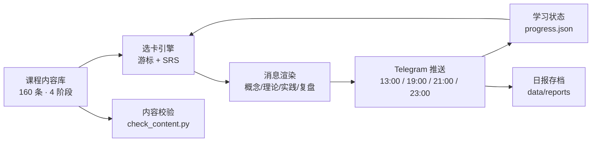
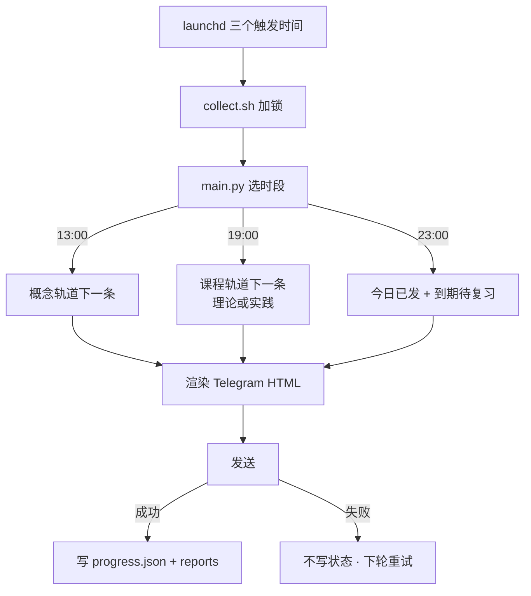
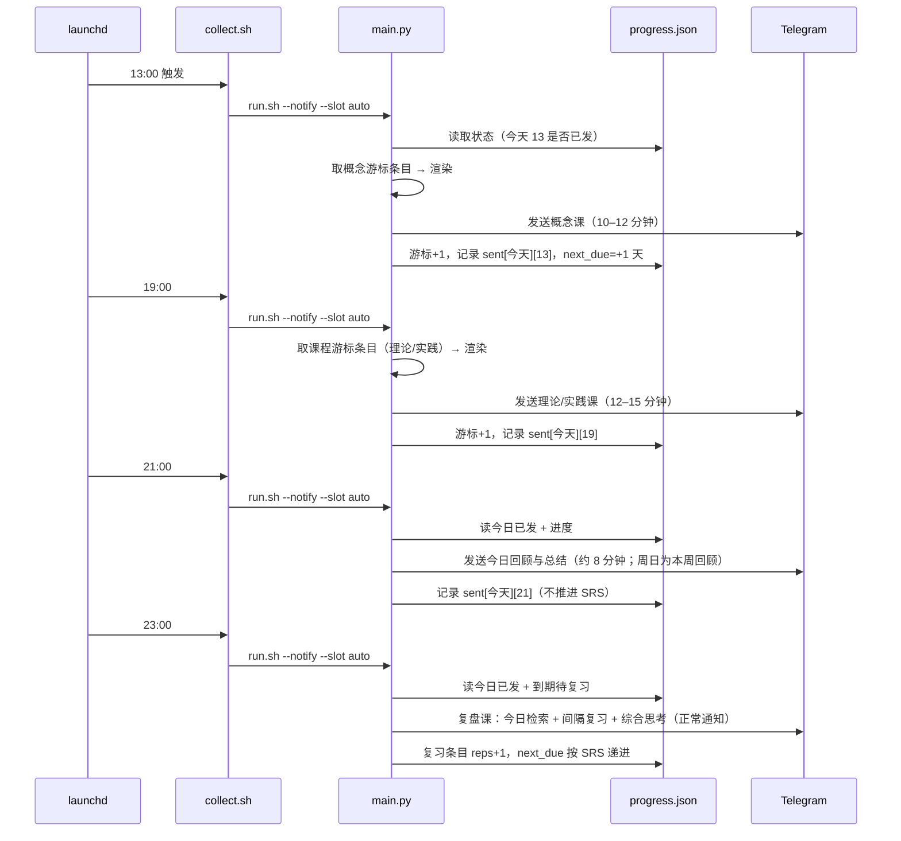

# 业务架构：crypto-knowledge

> 只画本模块的业务能力与数据流；仓库级分层/调度见 [../architecture.md](../architecture.md)。

## 1. 业务能力

## 2. 业务数据流

## 3. 关键流程：一天的三个班次

## 4. 内容阶段与主题

| 阶段 | 主题 | 概念 | 理论 | 实践 |
|---|---|---|---|---|
| 1 | 基础：货币、账本、密码学、比特币 | 20 | 12 | 8 |
| 2 | 机制：以太坊、L2、稳定币、DeFi | 20 | 12 | 8 |
| 3 | 市场：交易所、链上数据、代币经济、宏观 | 20 | 10 | 10 |
| 4 | 输出：监管、安全、前沿、研究方法 | 20 | 11 | 9 |

## 5. 与其它模块的关系

- **只读**：不依赖任何其它 `crypto-*` 模块的运行时数据；课程内容里引用了 `crypto-price` / `crypto-onchain` / `crypto-policy` 的公开 exports 作为实践素材，但不 import、不写入。
- **共享层**：配置/存储/时间/Telegram 推送来自 `libs/crypto_core`。
- **运维**：`tools/render_launchd.py` 安装调度，`tools/healthcheck.py` 做运行期自检，`tools/prune.py` 清理日志。
