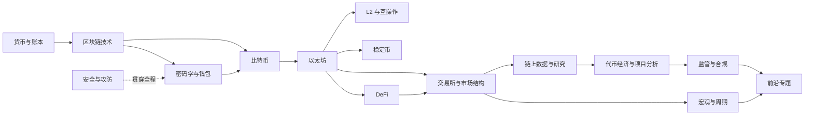

# 加密行业学习方案 v0.5（研究导向 · 长期碎片化）

> **定位**：兴趣爱好者，抱着**学习与研究**目的系统了解加密数字行业；**不交易、不出入金、不荐股、不提供投资建议**。
> **适用对象**：境内用户，无数字资产持仓，只使用公开资料、公开数据与测试网（合规基线见 §2.3）。
> **版本**：v0.5（2026-11-10）· **状态：已确认并落地**（已实现为 `crypto-knowledge` 模块，每天 4 条推送；周日 21:00 为本周回顾）。
> **一句话**：用 16 周的主题弧线定义「学什么、按什么顺序」，再用每天 3 节 10–15 分钟课程 + 21:00 回顾总结长期推进，把「看得懂新闻 → 读得懂白皮书 → 查得动链上数据 → 写得出可证伪结论」跑通。

---

## 0. 一页纸

| 项 | 结论 |
|---|---|
| **目标** | 建立可迁移的行业认知框架 + 可复跑的研究方法，而不是背名词、追热点 |
| **周期** | **长期**（每周 3–4h 或更少，碎片化）；16 周只定义主题顺序，不设截止日 |
| **投入** | 每天 4 条（3 节 10–15 分钟 + 8 分钟总结）≈ 每周 4.5–5.5h；吃饭、通勤、睡前完成 |
| **主线** | **BTC / ETH 为主轴**；BNB 作为「交易所生态」样本；SOL 及其他生态只做对照，不深挖 |
| **实验台** | 本仓库已有的 `crypto-news` / `crypto-price` / `crypto-analyst` / `crypto-onchain` / `crypto-policy` / `crypto-jobs` / `crypto-x-kol` 的公开数据与 exports |
| **产出** | ① 16 篇周笔记 ② 6 个动手项目（P1–P6） ③ 1 篇 3000 字专题研报 ④ 个人研究框架 v1 |
| **落地** | 已实现为 `crypto-knowledge`：13:00 概念课 / 19:00 理论或实践课 / 21:00 回顾总结 / 23:00 复盘课，间隔复习 1/3/7/14/30/60 天 |
| **不做什么** | 不交易、不出入金、不碰杠杆/合约、不参与 ICO/空投 farming、不代客理财、不给投资建议 |
| **成功标准** | 能独立完成一次「事件 → 数据 → 归因 → 可证伪判断 → 事后复盘」的闭环，且结论可回溯到一手材料 |

---

## 1. 设计原则（为什么这样排）

1. **先机制、后叙事**：先搞懂「它为什么能成立、代价是什么」，再看「市场在讲什么故事」。叙事会过期，机制不会。
2. **一手优先**：白皮书、EIP、监管原文、链上数据 > 媒体解读 > KOL 观点。二手材料只用来「发现线索」，不用来「下结论」。
3. **输出倒逼输入**：每周必须留下一个可检查的产物（笔记/图表/脚本/研报）；没有产物的学习不算完成。
4. **用现成仓库当实验台**：你已经有新闻、行情、链上、政策、招聘、KOL 六条数据管线——每周的分析都从自己的 exports 出发，比看别人的结论更接近研究。

---

## 2. 定位与边界

### 2.1 学完要能做到（能力清单）

1. 用 3 句话向非专业者解释：区块链解决什么问题、比特币和以太坊差在哪、稳定币为什么重要。
2. 独立读懂一份白皮书 / EIP / 监管文件的核心主张与前提假设。
3. 在 Etherscan / Dune / DeFiLlama / Glassnode 上查到一个具体事实，并说明数据口径与局限。
4. 看懂一条行业新闻背后的**机制**（谁受益、谁受损、什么条件下会失效）。
5. 写出「结论 + 证据 + 反证条件 + 置信度」四件套齐全的分析，而不是观点输出。
6. 识别 90% 以上的常见骗局与安全风险（钓鱼、授权、假空投、貔貅盘、假客服）。

### 2.2 明确不学（避免跑偏）

- **不做交易技能**：K 线形态、合约开仓、杠杆、网格、跟单——这些不是「行业知识」，且与你的研究定位冲突。
- **不追百倍叙事**：新公链、meme、空投教程默认不学；只在「它改变了什么结构」时作为案例。
- **不囤资料**：不追求「收藏 100 个链接」，而是每个主题吃透 1–2 个一手材料。
- **不预测价格**：可以判断「状态与条件」，不写「必涨/必跌/目标价」。

### 2.3 合规基线（先划红线，再谈学习）

> **重要：2026-02-06 起，中国内地监管框架已更新。** 八部门《关于进一步防范和处置虚拟货币等相关风险的通知》（银发〔2026〕42 号）自发布之日起施行，**同时废止 2021 年「924 通知」（银发〔2021〕237 号）**。以下只列与学习相关的要点（全文见附录 C；不构成法律意见）：

- **虚拟货币业务一律禁止**：法币兑换、币币兑换、作为中央对手方买卖、信息中介与定价、代币发行融资、相关金融产品交易，均属非法金融活动；境外单位/个人不得以任何形式向境内主体提供相关服务。
- **RWA 代币化首次被点名**：境内开展 RWA 代币化及中介、信息技术服务应予以禁止（经业务主管部门同意、依托特定金融基础设施的除外）；未经同意/备案，不得赴境外开展 RWA 业务；境外机构不得向境内提供 RWA 服务。
- **挂钩人民币的稳定币**：未经同意，境内外任何单位/个人不得在境外发行。
- **民事后果**：投资虚拟货币、RWA 及相关金融产品，违背公序良俗的民事法律行为无效，损失自行承担。
- **学习含义**：内地学习者只做「不碰资金的研究」——读文档、跑测试网、看公开链上数据；**不碰资金、不参与交易、不发行/推广任何代币或 RWA 产品**。
- **香港**：SFC 自 2023 年起实施 VASP 发牌；《稳定币条例》2025-08 生效，2026 年进入发牌实施阶段。香港与内地是两套框架，不要混用。
- **其他辖区**：按所在地法律与税务规定执行；税务问题咨询专业人士，本方案不提供法律/税务意见。
- **自我约束**：本方案产生的所有分析仅用于方法研究，**不构成投资建议**，不对外提供交易指引。

### 2.4 安全基线（第一周就要做完）

- **钱包只用测试网**：不创建存放真实资产的钱包；如已有，单独隔离，不在学习设备上操作。
- **绝不输入助记词/私钥**：任何网站、客服、空投、问卷索要助记词 = 诈骗。
- **链接只从官网进**：书签固定入口，不点推特/电报里的短链。
- **授权管理**：每季度用 revoke.cash 检查一次授权；学习用的测试钱包也照做。
- **双设备习惯**：查资料/点链接的设备 与 有资产的设备分离（没有资产也建议养成）。

---

## 3. 2026 行业坐标（学之前先看地图）

> 只写结构性变化，不写价格；所有时点以官方文档为准，不确定的标「待核实」。本节建议在 W1 前读一遍，W16 再回看。

### 3.1 三个结构性变化

**① 合规化 / 机构化（监管成为一手材料）**

- 美国：现货 BTC ETF 2024-01 上线；GENIUS Act 2025-07-18 签署成法；OCC 实施细则 2026-10-21 发布、**2027-01-18 生效**。
- 欧盟：MiCA 2024-12-30 全面适用。
- 香港：《稳定币条例》2025-08 生效，2026 年进入发牌实施阶段。
- 中国内地：2026-02-06 八部门 42 号文施行，**废止 2021 年 924 通知**，并把 RWA 代币化纳入分类监管（细节见 §2.3）。
- 资本侧：a16z Crypto 于 2026-10 更名 **a16z Frontier**，投资范围扩展到更广的 frontier tech——「crypto」正在融入更大的技术叙事。

**② 以太坊以 Rollup 为中心的扩容**

- 时间线：Dencun 2024-03（EIP-4844 blob）→ Pectra 2025-05-07（EIP-7702，blob 目标升至 6）→ Fusaka 2025-12-03（PeerDAS，BPO 让 blob 扩容不再等硬分叉）→ Glamsterdam **计划 2026 Q4、日期未定**（ePBS / EIP-7732、BAL / EIP-7928）。
- 行业侧：原 L2Beat 已更名 **ETHBEAT**；L2 进入整合期，头部 rollup 集中度上升。学习重点是 blob/DA 费用、排序器权力、桥的信任假设，而不是追单条 L2。

**③ 应用层转向真实用途 / 现金流**

- 观察对象：稳定币支付与跨境结算、RWA 代币化、perp DEX、预测市场、AI agent 支付、DePIN。
- 量级参考（2026 年行业统计，只用于建立数量感，不作投资依据）：稳定币总市值约 $290B；非稳定币 RWA 约 $33.7B（其中美债约 $15.5B）；perp DEX 占永续成交约 12%；ERC-4337 智能账户超 3000 万个。
- 判断项目：看收入、真实用户、单位经济，而不是叙事热度。

> 事实来源见附录 C；市场数字随行情变化，引用前请自行核对。

### 3.2 一句话

**2026 年学 crypto，一半是技术，一半是监管与市场结构。** 内地学习者还要多一层：**先把合规边界搞清楚**——它决定了你能碰什么、不能碰什么。

---

## 4. 知识地图

### 4.1 目标层级定义

| 层级 | 含义 | 检验方式 |
|---|---|---|
| **L1 能解释** | 能用 3 句话向非专业者讲清「解决什么问题、代价是什么」 | 讲给一个完全不懂的朋友听，对方能复述 |
| **L2 能操作** | 能在工具里完成一次真实（测试网/公开数据）操作，能读懂一手数据 | 留下截图/脚本/交易哈希 |
| **L3 能判断** | 能对具体项目/事件给出有证据、可证伪的判断，并说明置信度与反证条件 | 写出「结论 + 证据 + 反证 + 置信度」 |

### 4.2 15 个知识域

| # | 知识域 | 要回答的核心问题 | 关键概念 | 目标 | 周次 |
|---|---|---|---|---|---|
| D1 | 货币、账本与信任 | 货币为什么需要账本？双花问题是什么？「信任最小化」的代价？ | 记账、信用、结算、双花、共识 | L1 | W1 |
| D2 | 区块链技术基础 | 哈希/Merkle 如何保证不可篡改？PoW 与 PoS 的取舍？UTXO 与账户模型差别？ | 哈希、Merkle、P2P、共识、分叉、UTXO、账户 | L2 | W2 |
| D3 | 密码学与钱包 | 私钥→公钥→地址怎么推导？助记词/HD/多签/MPC 的区别？ | 非对称加密、签名、地址、助记词、多签、MPC | L2 | W3 |
| D4 | 比特币 | 减半如何影响矿工经济？ETF 改变了什么？BTC L2 在解决什么？ | UTXO、矿工、难度、减半、Ordinals/Runes、ETF | L2 协议 / L3 经济 | W4 |
| D5 | 以太坊 | EVM 如何执行合约？Gas 怎么算？PoS 怎么保证安全？ | EVM、Gas、账户、合约、质押、EIP | L2 | W5–W6 |
| D6 | Layer2 与互操作 | Rollup 为什么便宜？排序器能做什么坏事？桥的信任假设？ | Rollup、DA、sequencer、桥、ETHBEAT 阶段 | L2 | W6 |
| D7 | 稳定币 | 三类稳定币的机制与脆弱点？脱锚如何修复？监管在管什么？ | 法币抵押、加密抵押、算法、脱锚、储备 | L2 | W7 |
| D8 | DeFi | AMM 如何定价？借贷如何清算？收益到底从哪来？ | AMM、无常损失、TVL、清算、MEV、收益来源 | L2 | W8 |
| D9 | 交易所与市场结构 | 订单簿 vs AMM？永续如何锚定现货？清算瀑布怎么形成？ | 订单簿、永续、资金费率、OI、做市、托管、PoR | L2 | W9 |
| D10 | 链上数据与研究 | 地址如何变成实体？哪些指标能区分「转移」与「卖出」？SQL 怎么写？ | 浏览器、地址聚类、Dune、指标、归因 | L2 工具 / L3 归因 | W10 |
| D11 | 代币经济与项目分析 | 供给/解锁/通胀如何影响价格？治理代币的价值捕获在哪？ | 供给曲线、解锁、通胀、治理、估值框架 | L2 | W11 |
| D12 | 宏观、周期与市场指标 | 流动性如何传导到 crypto？谁先动？ | 利率、DXY、ETF 流、MVRV、已实现市值、SOPR | L1 / L2 | W12 |
| D13 | 监管与合规 | 证券认定标准？三大辖区各管什么？内地边界在哪？ | Howey、MiCA、GENIUS、VASP、AML/KYC、Travel Rule | L2 框架 / L3 内地与香港 | W13 |
| D14 | 安全与攻防 | 常见攻击面？授权/签名/地址投毒怎么防？桥为什么最容易出事？ | 钓鱼、授权、多签、桥漏洞、MEV、供应链 | L2 / L3 | W14 |
| D15 | 前沿专题 | RWA/AI/DePIN/账户抽象各自解决什么问题？谁在买单？ | 代币化、AI agent、DePIN、ERC-4337/7702、意图 | L1 | W15 |

### 4.3 依赖关系（先学什么、后学什么）



> 读法：箭头是「前置知识」。W1–W12 是主干，W13–W16 是横切与输出；D14 安全不单独占一周，而是每周动手时顺带练。

---

## 5. 16 周路线图

### 5.1 总览

| 阶段 | 周次 | 主题 | 阶段产出 |
|---|---|---|---|
| **一、地基** | W1–W4 | 货币 → 区块链 → 密码学/钱包 → 比特币 | 能解释一笔 BTC 交易；完成测试网钱包 |
| **二、机制** | W5–W8 | 以太坊 → L2/互操作 → 稳定币 → DeFi | 测试网部署合约；完成一次稳定币/DeFi 机制拆解 |
| **三、市场** | W9–W12 | 市场结构 → 链上数据 → 代币经济 → 宏观周期 | 一次完整归因；一份 1000 字项目分析 |
| **四、输出** | W13–W16 | 监管 → 安全 → 前沿 → 综合研报 | 3000 字专题研报 + 研究框架 v1 |

> 这 16 周现在只作为**主题顺序**；实际按 `crypto-knowledge` 的每日推送长期推进，不设截止日。

### 5.2 阶段一：地基（W1–W4）

| 周 | 主题 | 核心问题 | 一手材料 | 动手 / 产出 |
|---|---|---|---|---|
| W1 | 货币、账本与信任 | 为什么需要区块链？双花问题怎么产生？「信任最小化」的代价是什么？ | 比特币白皮书 §1–2；《货币未来》第 1–2 章 | 画「物物交换 → 金属 → 纸币 → 电子现金」演进图；300 字说明「为什么不能直接给数字文件记账」 |
| W2 | 区块链技术基础 | 哈希/Merkle 如何保证不可篡改？PoW 与 PoS 各付出什么代价？UTXO 与账户模型差别？ | 《Mastering Bitcoin》第 1–2、6 章（GitHub 免费）；mempool.space 区块页 | 在 mempool.space 找一笔 ≥10 BTC 交易，记录输入/输出/手续费/确认数；在 blockchair 查一个区块的 Merkle 根 |
| W3 | 密码学与钱包 | 私钥→公钥→地址如何推导？助记词/HD/多签/MPC 的区别？自托管的真实风险？ | 《Mastering Bitcoin》第 4–5 章；ethereum.org「钱包」文档 | 创建 Sepolia 测试钱包：备份 → 删除 → 用助记词恢复；领取测试 ETH 转一笔；用 revoke.cash 读授权列表 |
| W4 | 比特币 | 减半如何改变矿工收入结构？ETF 的申赎如何影响现货？BTC L2 在解决什么？ | 白皮书全文；Bitcoin Optech 一期周报；Farside ETF 数据 | Glassnode 免费指标截 3 张（MVRV/已实现市值/活跃地址）；500 字「BTC 的三层价值主张：货币 / 结算网络 / 机构资产」 |

### 5.3 阶段二：机制（W5–W8）

| 周 | 主题 | 核心问题 | 一手材料 | 动手 / 产出 |
|---|---|---|---|---|
| W5 | 以太坊（一）：EVM 与交易 | 一笔交易从签名到上链经历什么？Gas 怎么算？nonce 为什么重要？ | ethereum.org 开发者文档（EVM / Gas / 交易）；《Mastering Ethereum》第 1–2、13–14 章 | 用 Remix 在 Sepolia 部署一个最小 ERC-20；在 Etherscan 读一笔 swap 的 logs 与 internal tx |
| W6 | 以太坊（二）+ L2 | PoS 怎么保证安全？Rollup 为什么便宜？排序器能审查交易吗？桥的信任假设有哪几类？ | ethereum.org roadmap（Pectra/Fusaka/Glamsterdam）；ETHBEAT（原 L2Beat）风险框架 | 在 ETHBEAT 选 3 个 L2 对比阶段/TVL/DA 方案；用 Dune 看 blob 费用趋势；500 字「L2 的风险到底在哪」 |
| W7 | 稳定币 | 三类稳定币的机制与脆弱点？脱锚时套利者如何修复？监管在管什么？ | GENIUS Act 摘要 + OCC 终规（2026-10）；MiCA 稳定币条款（ESMA）；香港《稳定币条例》（HKMA）；USDC/Tether 储备报告 | 用 DefiLlama 稳定币页看总供应与链分布；复盘 USDC 2023 / UST 2022 两次脱锚；表格式对比三类机制 |
| W8 | DeFi | AMM 如何定价？无常损失怎么来的？借贷如何清算？收益到底从哪来？ | Uniswap v2 白皮书；Aave 文档；DeFiLlama | 用 DeFiLlama 看 Top10 协议收入；Dune 查一个池子的 TVL/费率；500 字「DeFi 收益来源分类：手续费 / 利息 / 激励 / MEV」 |

### 5.4 阶段三：市场（W9–W12）

| 周 | 主题 | 核心问题 | 一手材料 | 动手 / 产出 |
|---|---|---|---|---|
| W9 | 交易所与市场结构 | 订单簿 vs AMM？永续资金费率如何锚定现货？清算瀑布怎么形成？PoR 能证明什么？ | BitMEX 永续白皮书；Binance/OKX 合约规则页；交易所 PoR 报告 | 连续 5 天读 `crypto-price/data/exports/latest.json`（funding_rate / OI / 三源价差），记录一次异动并写归因；对比 3 家交易所同一时刻报价 |
| W10 | 链上数据与研究 | 地址如何变成实体？哪些指标能区分「转移」与「卖出」？SQL 怎么写？ | Dune 文档 + 官方看板；Nansen/Glassnode 指标说明；本仓库 `crypto-onchain` 归因规则 | 用 Dune 写第一个查询（如 USDT 日转账额）；用 `crypto-onchain` 的 walletflow 数据验证「大额转账 ≠ 卖压」；产出 1 张图 + 300 字 |
| W11 | 代币经济与项目分析 | 供给/解锁/通胀如何影响价格？治理代币的价值捕获在哪？白皮书怎么读？ | Messari / Token Terminal 方法论文；一个非 BTC/ETH 项目的 tokenomics 章节 | 选 1 个项目（只研究不投资）写 1000 字分析：需求 / 供给 / 竞争 / 风险 / 反证条件 |
| W12 | 宏观、周期与市场指标 | 流动性如何传导到 crypto？ETF 流、稳定币增发、杠杆率谁先动？ | FRED 数据说明；Farside ETF flows；Glassnode 周期指标 | 用 `crypto-analyst` 的 FRED/DXY/DVOL 数据画 3 张图；500 字「当前周期的 3 个观察指标 + 失效条件」 |

### 5.5 阶段四：输出（W13–W16）

| 周 | 主题 | 核心问题 | 一手材料 | 动手 / 产出 |
|---|---|---|---|---|
| W13 | 监管与合规 | Howey 四要件？MiCA / GENIUS / 香港各管什么？42 号文与已废止的 924 是什么关系？ | SEC/CFTC 指引摘要；ESMA MiCA 概览；**42 号文全文**（商务部法规网）+ 924 历史；本仓库 `crypto-policy` 法规库 | 整理「辖区 × 监管对象 × 关键要求」表；从 `crypto-policy` 取 3 条法规写摘要 |
| W14 | 安全与攻防 | 常见攻击面有哪些？授权/签名/地址投毒怎么防？桥为什么是重灾区？ | rekt.news 排行榜；SlowMist / ScamSniffer 年度报告；revoke.cash 文档 | 复盘 3 个真实案例（Ronin / Wormhole / Bybit 2025）；写一份「个人威胁模型」清单 |
| W15 | 前沿专题 | RWA / AI+Crypto / DePIN / 账户抽象各自解决什么问题？谁在买单？ | EIP-4337 / 7702；a16z / Paradigm 专题文章；RWA.xyz | 选 1 个专题写 1500 字，按「技术 → 产品 → 监管 → 商业模式」四层拆 |
| W16 | 综合研究与输出 | 我的研究框架是什么？哪些判断被证伪？下一步学什么？ | 自己前 15 周的笔记与研报 | 3000 字专题研报 + 16 周复盘 + 下一阶段路线 v2 |

### 5.6 时间不够时怎么裁

按「删掉不影响主干」的顺序裁：**W15 前沿 → W14 案例减到 1 个 → W12 宏观 → W2 的 Merkle 细节**。  
**不能删**：W3 钱包与安全、W5 以太坊、W7 稳定币、W9 市场结构、W10 链上数据、W13 监管——这六周构成研究能力的骨架。

---

## 6. 学习方法：每周四步 + 双周复盘

### 6.1 每周四步（固定节奏，别改）

| 步骤 | 时长 | 做什么 | 产出 |
|---|---|---|---|
| ① 读 | 2h | 一手材料 1 篇（白皮书章节 / EIP / 监管原文）+ 二手综述 1 篇（只用来定位背景） | 3 条「我以为 vs 实际上」的认知修正 |
| ② 看 | 0.5h | 官方文档 / 课程视频 / 协议看板，带着第 ① 步的问题看 | 1 个待验证的问题 |
| ③ 做 | 2h | 打开工具，完成本周「动手」；截图、存哈希、存脚本 | 可复跑的操作记录 |
| ④ 写 | 1.5h | 300–500 字笔记 + 1 张表 / 图；写清「结论、证据、不确定」 | 本地 `learning/notes/wXX-*.md`（不入库） |

> 原则：**宁可一周只吃透一个概念，也不要一周刷完十个视频。**

### 6.2 笔记模板（直接复制）

```markdown
# W{周} · {主题}

## 一句话结论
（我原来以为……，现在认为……，因为……）

## 关键机制（3–5 条）
1. ……

## 证据（链接 / 交易哈希 / 数据截图）
- ……

## 不确定 / 反证条件
- 如果出现 ……，则上面的结论不成立

## 本周新词（每个词用自己的话解释，不许抄定义）
- 词：……

## 下周要验证的问题
1. ……
```

### 6.3 信息源管理（防信息过载）

- **订阅上限 5 个**：1 个综合媒体 + 1 个数据平台 + 1 个监管源 + 1 个播客/Newsletter + 1 个中文深度号。
- 每天只看 **标题 + 首段**，值得深读的才点开；不值得的 30 秒关掉。
- 每月淘汰一个「连续 4 周没带来新信息」的源。
- 本仓库的 `crypto-news` / `crypto-policy` / `crypto-x-kol` 已经做了信源分层与降噪——**学习期直接读它的日报，不自己刷推特**。

### 6.4 双周复盘（隔周日 30 分钟）

1. 这两周我真正搞懂了哪 3 个机制？（说不出来 = 没学到）
2. 哪个「我以为懂了」被证伪了？
3. 下一个双周要补哪一块？删掉哪个低价值动作？

---

## 7. 动手项目（P0–P6，由浅入深）

> 所有项目都在**测试网 / 公开数据 / 只读**范围内完成，不涉及真实资金。

| 编号 | 项目 | 对应周 | 预计 | 验收标准 |
|---|---|---|---|---|
| P0 | 工具与安全基线 | W0 | 2h | 装好钱包/浏览器书签/笔记目录；写下一份「绝不做的 5 件事」清单 |
| P1 | 读懂一笔比特币交易 | W2 | 1.5h | 能说出输入、输出、找零、手续费、确认数各是什么；贴交易链接 |
| P2 | 测试钱包全流程 | W3 | 2h | 创建 → 备份 → 删除 → 恢复 → 转账成功；贴测试网交易哈希 |
| P3 | 测试网部署 ERC-20 | W5 | 2h | Remix 部署成功 + Etherscan 验证 + 解释每个函数的作用 |
| P4 | 一次完整归因 | W9–W10 | 4h | 用 `crypto-price` + `crypto-onchain` 数据写「现象 → 证据 → 归因 → 反证」一页纸 |
| P5 | 一个项目的机制分析 | W11 | 4h | 1000 字：需求 / 供给 / 竞争 / 风险 / 反证条件，全部可回溯 |
| P6 | 专题研报 | W16 | 8h | 3000 字：问题 → 框架 → 证据 → 结论 → 反证 → 局限 |

**P0 清单（W0 一次做完）**

1. 装 Rabby 或 MetaMask（只用于测试网），另装一个硬件钱包可后置。
2. 浏览器书签固定 8 个入口：Etherscan / mempool.space / ETHBEAT / DeFiLlama / Dune / Glassnode / Farside / 本仓库日报。
3. 在**本地**建 `learning/` 目录（结构见 §12；`.gitignore` 不入库）。
4. 注册免费账号：Dune、Glassnode 免费档、DefiLlama（无需注册）。
5. 写下并贴在显示器旁：**不输入助记词、不点私信链接、不参与空投、不交易、不借钱**。

---

## 8. 资源库（按优先级，不追求全）

> 外链可能失效：**入口以官网首页 / 站内搜索为准**；监管与法规优先用本仓库 `crypto-policy` 的法规库（已做中文归档）。

### 8.1 一手文档（最高优先级）

| 资源 | 链接 | 用途 |
|---|---|---|
| 比特币白皮书 | https://bitcoin.org/bitcoin.pdf | W1、W4 精读 |
| Bitcoin Optech | https://bitcoinops.org/ | 跟踪 BTC 技术演进（周报） |
| 以太坊白皮书 | https://ethereum.org/en/whitepaper/ | W5 前读 |
| 以太坊开发者文档 | https://ethereum.org/en/developers/docs/ | W5–W6 主教材 |
| 以太坊路线图 | https://ethereum.org/en/roadmap/ | 升级时点以此为准 |
| EIP 索引 | https://eips.ethereum.org/ | 查具体提案（4337/7702/4844） |
| ETHBEAT（原 L2Beat） | https://ethbeat.org/ | L2 风险阶段、TVL、DA 方案 |
| 中国 42 号文全文 | https://policy.mofcom.gov.cn/claw/clawContent.shtml?id=104982 | W13 必读；已废止 924 |
| OCC GENIUS 终规（2026-10） | https://occ.treas.gov/news-issuances/bulletins/2026/bulletin-2026-50.html | W7 / W13 |
| DeFiLlama | https://defillama.com/ | TVL、稳定币、协议收入 |
| Etherscan | https://etherscan.io/ | 读交易、合约、授权 |
| mempool.space | https://mempool.space/ | BTC 内存池、区块、手续费 |
| Farside ETF | https://farside.co.uk/btc/ | 现货 ETF 资金流 |
| 监管原文 | SEC https://www.sec.gov/ · CFTC https://www.cftc.gov/ · HKMA https://www.hkma.gov.hk/ · SFC https://www.sfc.hk/ · ESMA https://www.esma.europa.eu/ · 中国央行 http://www.pbc.gov.cn/ | W7、W13 必读 |

### 8.2 书（选 2–3 本，不要全买）

| 书 | 说明 | 读法 |
|---|---|---|
| 《Mastering Bitcoin》 | 技术圣经，GitHub 免费：https://github.com/bitcoinbook/bitcoinbook | W2–W4 精读相关章节 |
| 《Mastering Ethereum》 | 以太坊技术，GitHub 免费：https://github.com/ethereumbook/ethereumbook | W5 精读 |
| 《The Bitcoin Standard》 | 货币经济学视角，**观点强，需批判阅读** | W1 选读 |
| 《Cryptoassets》 | 估值框架（Burniske） | W11 参考 |
| 《The Infinite Machine》 | 以太坊早期史，理解社区与治理 | 通勤读物 |
| 《How to DeFi》（CoinGecko） | DeFi 入门，偏操作 | W8 速读 |

### 8.3 课程（免费优先）

| 课程 | 链接 | 适合 |
|---|---|---|
| MIT OCW 15.S12 Blockchain and Money | https://ocw.mit.edu/courses/15-s12-blockchain-and-money-fall-2018/ | 建立金融+监管视角（经典） |
| MIT OCW 14.129（2025 春） | https://ocw.mit.edu/courses/14-129-blockchain-and-the-design-of-financial-systems-spring-2025/ | 经济学 + CS 交叉，最新版 |
| Princeton《Bitcoin and Cryptocurrency Technologies》 | https://www.coursera.org/learn/cryptocurrency | 密码学与共识打底 |
| a16z Frontier（原 a16z crypto） | https://a16zfrontier.com/ | 行业视角、创业与监管 |
| Cyfrin Updraft | https://updraft.cyfrin.io/ | 智能合约安全（免费） |
| Speedrun Ethereum | https://speedrunethereum.com/ | 动手学 Solidity |
| Foundry Book | https://book.getfoundry.sh/ | 合约开发工具链 |

### 8.4 数据与研究平台

| 平台 | 链接 | 免费度 | 用途 |
|---|---|---|---|
| Dune | https://dune.com/ | 免费增值 | 写 SQL 查链上数据 |
| ETHBEAT | https://ethbeat.org/ | 免费 | L2 风险框架、TVL、DA |
| ultrasound.money | https://ultrasound.money/ | 免费 | ETH 供应量与销毁 |
| Glassnode | https://glassnode.com/ | 免费档有限 | 周期指标（MVRV/SOPR） |
| Nansen | https://www.nansen.ai/ | 付费为主 | 地址标签、聪明钱 |
| Arkham | https://arkhamintelligence.com/ | 免费增值 | 实体/地址情报 |
| Messari | https://messari.io/ | 免费增值 | 项目研究与季度报告 |
| Token Terminal | https://tokenterminal.com/ | 免费增值 | 协议收入/估值 |
| CoinGecko | https://www.coingecko.com/ | 免费 | 基础行情与供应量 |
| Deribit | https://www.deribit.com/ | 免费 | 期权 DVOL 波动率 |
| RWA.xyz | https://www.rwa.xyz/ | 免费 | RWA 代币化数据 |
| rekt.news | https://rekt.news/ | 免费 | 黑客事件复盘（W14） |

### 8.5 资讯 / 播客 / Newsletter

| 类型 | 推荐 | 定位 |
|---|---|---|
| 英文媒体 | The Block · CoinDesk · Blockworks · DL News | 快讯与深度，交叉验证 |
| 中文媒体 | PANews · 律动 BlockBeats · 吴说 · 深潮 TechFlow · Foresight News · 链捕手 · Odaily | 中文语境与监管解读 |
| 播客 | Bankless · Unchained · Epicenter · Bell Curve · Empire · Zero Knowledge · 0xResearch | 通勤听，建立「问题感」 |
| 技术社区 | 登链社区 https://learnblockchain.cn/ | 中文技术教程 |

### 8.6 工具与安全

| 工具 | 链接 | 说明 |
|---|---|---|
| Remix | https://remix.ethereum.org/ | 在线写/部署合约（W5） |
| Sepolia 水龙头 | https://www.alchemy.com/faucets/ethereum-sepolia | 领测试 ETH（需免费账号） |
| revoke.cash | https://revoke.cash/ | 查/撤销授权（W3、W14） |
| Chainlist | https://chainlist.org/ | 添加网络，防手动填错 RPC |
| Tenderly | https://tenderly.co/ | 交易模拟与调试 |
| viem / web3.py | https://viem.sh/ · https://web3py.readthedocs.io/ | 写脚本读链上数据 |
| Rabby / MetaMask | https://rabby.io/ · https://metamask.io/ | 测试网钱包 |
| Ledger / Trezor | https://www.ledger.com/ · https://trezor.io/ | 硬件钱包（有真实资产才需要） |

---

## 9. 评估与里程碑

### 9.1 四个里程碑（达不到就补，不往后赶）

| 里程碑 | 时间 | 通过标准（可检查） |
|---|---|---|
| **M1 地基** | W4 末 | ① 手画出「私钥 → 公钥 → 地址」推导图；② 说清 UTXO 与账户模型差别；③ 测试钱包完成「备份→删除→恢复」；④ 500 字 BTC 三层价值主张 |
| **M2 机制** | W8 末 | ① Sepolia 上有自己的 ERC-20 合约地址；② 能画出一次 swap 的完整资金流与费用；③ 三类稳定币机制对比表；④ 500 字 DeFi 收益来源分类 |
| **M3 市场** | W12 末 | ① 1 个自己写的 Dune 查询链接；② 一张归因图 + 300 字；③ 1000 字项目机制分析；④ 500 字周期观察（含失效条件） |
| **M4 输出** | W16 末 | ① 3000 字专题研报；② 16 篇周笔记齐全；③ 研究框架 v1（一页纸）；④ 复盘：哪些判断被证伪 |

### 9.2 自测题（答不出 → 回看对应周）

**第一阶段（W1–W4）**

1. 为什么比特币用 UTXO 而不是账户余额模型？各自代价是什么？→ W2
2. 一笔比特币交易的输入、输出、找零、手续费分别是什么？手续费由什么决定？→ W2
3. 助记词、私钥、公钥、地址的推导关系？为什么地址可以公开而私钥不行？→ W3
4. PoW 的「最长链」规则解决什么问题？51% 攻击能做什么、不能做什么？→ W2
5. 减半后矿工收入结构如何变化？为什么手续费市场是长期安全问题？→ W4

**第二阶段（W5–W8）**

6. 一笔以太坊交易从签名到上链经历哪些步骤？nonce 的作用是什么？→ W5
7. EIP-1559 的 base fee 被销毁，这改变了什么激励？→ W5
8. Rollup 的 sequencer 能做哪些「坏事」？ETHBEAT 的 stage 0/1/2 分别要求什么？→ W6
9. 法币抵押稳定币脱锚时，套利者如何把价格拉回？什么情况下套利失效？→ W7
10. Uniswap v2 的 `x*y=k` 在大额卖出时价格如何变化？无常损失是什么？→ W8
11. 借贷协议在什么条件下触发清算？清算罚金和坏账怎么产生？→ W8

**第三阶段（W9–W12）**

12. 永续合约的资金费率如何让永续价格锚定现货？正费率时谁付谁？→ W9
13. 清算瀑布如何形成？为什么 OI 骤降常伴随插针？→ W9
14. 储备证明（PoR）能证明什么、不能证明什么？→ W9
15. 链上「大额转账」为什么不能直接等同于「卖出」？需要哪些额外证据？→ W10
16. 代币解锁为什么可能形成卖压？线性解锁 vs 悬崖解锁的差别？→ W11
17. MVRV、已实现市值、SOPR 各自衡量什么？为什么它们不是「买卖信号」？→ W12
18. 现货 ETF 的净流入如何影响现货价格？申购赎回机制是什么？→ W4 / W12

**第四阶段（W13–W16）**

19. Howey 测试的四个要件？为什么「足够去中心化」是监管争论焦点？→ W13
20. 2026 年 42 号文相对 2021 年 924 通知，延续了什么、新增了什么？与香港路径的差异在哪？→ W13
21. 授权（approve）风险是什么？无限授权与按需授权的取舍？→ W3 / W14
22. 桥为什么是攻击重灾区？跨链消息验证的信任假设有哪几类？→ W6 / W14

> 通过标准：**能用自己的话讲 3 分钟，且能说出至少 1 个反例或局限**。只背结论不算通过。

---

## 10. 常见坑与反诈（按风险从高到低）

### 10.1 认知坑

1. **把价格当知识**：价格是结果，不是原因。看到涨跌先问「哪个机制变了」，答不出就说明还没学到。
2. **术语堆砌**：能背「模块化、DA、MEV」不等于懂。检验标准只有一个：能用自己的话 + 一个反例讲清。
3. **幸存者偏差**：只看百倍项目，不看归零项目。每读一个成功案例，配一个失败案例（rekt.news 是现成的）。
4. **叙事归因**：涨了找理由、跌了找理由。研究要做的是**事前写下可证伪条件**，而不是事后解释。

### 10.2 信息坑

5. **信源无限扩张**：订阅 20 个号 = 没有信源。上限 5 个，每月淘汰一个。
6. **二手当一手**：媒体标题 → 原文 → 数据，至少回溯一层；监管类必须回到原文。
7. **旧闻当新闻**：看到「某交易所被黑」先看日期；2022 年的旧闻每年都会被翻炒。

### 10.3 安全坑（最高危）

8. **钓鱼网站**：域名差一个字母、谷歌广告位买假官网。只从书签进，不点搜索结果广告。
9. **假空投 / 假客服**：任何主动私信、索要助记词、让你「先付 gas 领空投」的，100% 是诈骗。
10. **盲签与无限授权**：签名前看清「授权给谁、授权多少」；不用时用 revoke.cash 撤销。
11. **地址投毒**：转账记录里出现相似地址，复制错就转给骗子；转账前核对首尾各 6 位。
12. **貔貅盘 / 蜜罐合约**：能买不能卖。学习期不碰任何「新币」，要看也只读合约代码。

### 10.4 合规与心态坑

13. **用「学习」当交易借口**：本方案的边界是不交易；一旦开始下单，研究就会变成找理由。
14. **借钱 / All in**：与学习无关，但这是行业里最常见的归零方式，写进红线。
15. **把研究结论当投资建议**：自己的结论只对自己负责，不对外输出交易指引。

---

## 11. 持续学习机制（16 周之后）

| 机制 | 频率 | 做法 |
|---|---|---|
| 信息维护 | 每周日 30 min | 读本周 `crypto-news` / `crypto-policy` 日报；删一个低价值源 |
| 案例库 | 每月 1 个 | 一个安全事件 / 一次脱锚 / 一次升级，写 300 字复盘进本地 `learning/cases/`（不入库） |
| 季度复盘 | 每 3 个月 | 回看 12 篇笔记：哪些结论被证伪？框架哪一条要改？ |
| 升级跟踪 | 事件驱动 | 以太坊升级、BTC 减半、重大立法——回来看一手文档，不看解读 |
| 输出 | 每季度 1 篇 | 1500 字以上，发不发都行，关键是逼自己形成完整论证 |

> **什么时候算「学够了」**：不是学完所有知识，而是**遇到一个新概念，你知道去哪查一手材料、怎么验证、怎么判断它重不重要**。达到这个状态，16 周的目标就完成了。

---

## 12. 落地

### 12.1 目录结构（本地创建 `learning/`，不入库；不建新代码模块）

```
learning/                     # 学习产物，与 crypto-* 代码模块解耦
├── README.md                 # 索引：周次 → 笔记链接
├── notes/                    # 16 篇周笔记（w01-*.md … w16-*.md）
├── projects/                 # 动手项目产物（截图、脚本、交易哈希）
├── cases/                    # 案例复盘（安全/脱锚/升级）
├── reports/                  # 1000 字项目分析、1500 字专题、3000 字研报
├── sources.md                # 信息源清单（≤5 个 + 淘汰记录）
├── log.md                    # 双周复盘（3 行：学到什么/被证伪什么/下步）
└── new-note.sh               # 从模板创建本周笔记
```

> 在**本地**创建 `learning/`（`.gitignore` 不入库）：模板（日/周/案例）、`new-note.sh`、信息源与双周复盘。每天 2 分钟、每周日 10 分钟。

### 12.2 把仓库变成实验台

| 周 | 用哪个模块 | 怎么用 |
|---|---|---|
| W1–W6 | `crypto-news` 日报 | 每天挑 1 条新闻，写「它触发了哪个机制」的一句话 |
| W7 | `crypto-onchain` 稳定币净增发 | 对照 DefiLlama 稳定币供应，验证「增发 ≠ 上涨」 |
| W9 | `crypto-price` exports | 读 `funding_rate` / `oi` / 三源价差，做一次异动归因 |
| W10 | `crypto-onchain` walletflow | 用「≥$5M 转账」数据练「转移 ≠ 卖出」的归因 |
| W11 | `crypto-jobs` 技能/招聘 | 看哪些赛道在招人、要什么技能，作为「行业热度」的旁证 |
| W12 | `crypto-analyst` 宏观数据 | 用 FRED / DXY / DVOL 画图，写周期观察 |
| W13 | `crypto-policy` 法规库 | 取 3 条法规做中文摘要与适用对象表 |

> 注意：只读 `data/exports/`，不读 `state/`、`raw/`；不修改任何 `crypto-*` 模块。

### 12.3 W0 准备清单（2 小时）

- [ ] 装 Rabby / MetaMask（仅测试网）
- [ ] 收藏 8 个固定入口（见 §7 P0）
- [ ] 本地建 `learning/` 目录与 16 篇笔记骨架（不入库）
- [ ] 注册 Dune / Glassnode 免费账号
- [ ] 读一遍本方案 + 写下一个「我的 16 周目标」（一句话）
- [ ] 写下并贴出 5 条红线

### 12.4 第一周日程示例（6.5h）

| 时间 | 动作 |
|---|---|
| 周一 20:00–21:00 | 读白皮书 §1–2 + 记 3 个问题 |
| 周三 20:00–20:30 | 看 ethereum.org「What is Ethereum」 |
| 周五 20:00–22:00 | 画演进图；写 300 字「为什么不能直接给数字文件记账」 |
| 周日 10:00–11:00 | 写 w01 笔记；30 min 双周复盘（本周为单周，只做周复盘） |

### 12.5 与代码模块的关系

- 本方案**不新增 `crypto-*` 模块**，不改任何现有代码与调度。
- 若某一周的成果值得产品化（例如「稳定币脱锚监测」），再按仓库约定 `make new-module` 另立需求，走「需求 → 设计 → 测试 → PR」流程。

---

## 13. 已确认决策（2026-11-09）

| 问题 | 决策 |
|---|---|
| 投入档位 | **长期学习**，每周 3–4h 或更少；重点不是速度，是长期坚持 + 碎片化时间 |
| 内容形式 | 每天 3 节 10–15 分钟课程、内容各不相同；理论 / 实践 / 概念术语都覆盖，由浅入深 |
| 主线范围 | BTC/ETH 为主，BNB 作交易所生态样本；SOL 只作对照 |
| 产物位置 | 模块代码在本仓库；学习笔记放本地 `learning/`（不入库） |
| 自动化 | 每天 **13:00 / 19:00 / 21:00 / 23:00** 四次推送，已接 launchd |
| 起跑 | 2026-11-09 起，次日 13:00 第一条 |

---

## 14. 已落地：crypto-knowledge 模块

- 代码 / 内容 / 文档：[`crypto-knowledge/`](../crypto-knowledge/README.md) · [需求](crypto-knowledge/requirement.md) · [设计](crypto-knowledge/design.md)
- 内容：**160 条**（概念 80 / 理论 45 / 实践 35），4 个阶段；格式规范见 [`config/curriculum/README.md`](../crypto-knowledge/config/curriculum/README.md)
- 节奏：13:00 概念课 / 19:00 理论或实践课 / 21:00 今日回顾与总结（周日为本周回顾）/ 23:00 复盘课（正常通知）；间隔复习 1/3/7/14/30/60 天
- 体验：`./crypto-knowledge/scripts/run.sh --status` 看进度；`--slot 13 --dry-run` 预览；`--slot 21 --weekly --dry-run` 预览周报
- 本方案的 16 周主题弧线已被内容库采用为 4 个阶段；**实际进度以推送为准，不按周硬赶**。

---

## 附录 A 术语表（先混个眼熟，学到再回填）

| 类别 | 术语 | 一句话 |
|---|---|---|
| 基础 | 区块链 | 按时间链接、由多方共同维护的账本 |
| 基础 | 哈希 | 把任意输入变成固定长度指纹的单向函数 |
| 基础 | Merkle 树 | 用哈希树把大量交易压缩成一个根，可证明某笔交易被包含 |
| 基础 | 共识 | 分布式节点对同一账本状态达成一致的过程 |
| 基础 | PoW | 用算力竞争出块权，安全来自算力成本 |
| 基础 | PoS | 用质押资产获得出块权，作恶被罚没 |
| 基础 | 分叉 | 链或协议的分裂；软分叉兼容、硬分叉不兼容 |
| 密码学 | 公私钥 | 一对数学关联的密钥，私钥签名、公钥验证 |
| 密码学 | 数字签名 | 用私钥签名，任何人可用公钥验证来源与完整性 |
| 密码学 | 地址 | 公钥经哈希/编码得到的收款标识 |
| 密码学 | 助记词 | 把随机种子编码成 12/24 个单词，用于恢复钱包 |
| 密码学 | HD 钱包 | 从一个种子派生出多个密钥对的分层确定性钱包 |
| 密码学 | 多签 | 需要 m-of-n 个私钥共同签名才能动用资金 |
| 比特币 | UTXO | 未花费交易输出，比特币的「钞票」模型 |
| 比特币 | 减半 | 每约 4 年区块奖励减半，约束总供应 |
| 比特币 | Ordinals / Runes | 在 BTC 上铭刻数据 / 发行同质化代币的协议 |
| 以太坊 | 账户模型 | 以余额和 nonce 记账，以太坊采用 |
| 以太坊 | EVM | 以太坊虚拟机，执行智能合约的运行时 |
| 以太坊 | Gas | 以太坊中计算与存储的计价单位 |
| 以太坊 | 智能合约 | 部署在链上、自动执行的代码 |
| 以太坊 | EIP | 以太坊改进提案，协议变更的正式流程 |
| 扩容 | Rollup | 执行放 L2、数据/证明回 L1 的扩容方案 |
| 扩容 | Blob / DA | 交易数据的临时存储（blob）与数据可用性（DA） |
| 扩容 | PeerDAS | Fusaka 引入的数据可用性采样，降低节点存储负担 |
| 扩容 | Sequencer | L2 中负责排序与打包交易的节点 |
| 扩容 | 桥 | 在两条链之间转移资产/消息的合约与验证机制 |
| 扩容 | ETHBEAT | 原 L2Beat，L2 风险阶段与 TVL 数据平台 |
| 稳定币 | 稳定币 | 锚定法币或资产的代币：法币抵押 / 加密抵押 / 算法 |
| 稳定币 | 脱锚 | 稳定币价格偏离锚定值 |
| DeFi | AMM | 用公式（如 x*y=k）自动定价的做市机制 |
| DeFi | 无常损失 | AMM 做市相对持币的机会成本 |
| DeFi | TVL | 锁在协议中的资产总价值 |
| DeFi | MEV | 通过排序/插入交易获取的额外价值 |
| 市场 | 永续合约 | 没有到期日的衍生品 |
| 市场 | 资金费率 | 永续多空之间定期支付的费用，用于锚定现货 |
| 市场 | 清算 | 抵押不足时强制平仓 |
| 市场 | OI | 未平仓合约总量 |
| 研究 | MVRV | 市值 / 已实现市值，衡量整体浮盈 |
| 研究 | 已实现市值 | 按每枚币最后一次链上移动的价格加总 |
| 研究 | SOPR | 花费产出利润率，衡量卖出盈亏 |
| 研究 | 代币解锁 | 锁仓代币按计划释放，可能形成卖压 |
| 监管 | Howey 测试 | 美国判断是否构成投资合同的四要件 |
| 监管 | MiCA | 欧盟加密资产市场监管法规 |
| 监管 | GENIUS Act | 美国稳定币立法（2025-07-18 成法，2027-01-18 生效） |
| 监管 | 42 号文 | 2026 年中国八部门通知，废止 924、首次分类监管 RWA |
| 监管 | VASP | 虚拟资产服务提供者 |
| 监管 | KYC / AML | 了解你的客户 / 反洗钱 |
| 监管 | Travel Rule | 转账需附带发起方/接收方信息的反洗钱规则 |
| 前沿 | RWA | 现实世界资产代币化 |
| 前沿 | DePIN | 去中心化物理基础设施网络 |
| 前沿 | 账户抽象 | 让账户具备合约逻辑（ERC-4337 / EIP-7702） |
| 前沿 | 意图 | 用户声明目标，由求解器竞争执行 |
| 前沿 | 零知识证明 | 证明「我知道某事实」而不泄露事实本身 |

## 附录 B 16 周打卡表

| 周 | 主题 | 笔记 | 动手 | 自测 | 完成 |
|---|---|---|---|---|---|
| W1 | 货币、账本与信任 | ☐ | ☐ | ☐ | ☐ |
| W2 | 区块链技术基础 | ☐ | ☐ | ☐ | ☐ |
| W3 | 密码学与钱包 | ☐ | ☐ | ☐ | ☐ |
| W4 | 比特币 | ☐ | ☐ | ☐ | **M1** ☐ |
| W5 | 以太坊（一） | ☐ | ☐ | ☐ | ☐ |
| W6 | 以太坊（二）+ L2 | ☐ | ☐ | ☐ | ☐ |
| W7 | 稳定币 | ☐ | ☐ | ☐ | ☐ |
| W8 | DeFi | ☐ | ☐ | ☐ | **M2** ☐ |
| W9 | 交易所与市场结构 | ☐ | ☐ | ☐ | ☐ |
| W10 | 链上数据与研究 | ☐ | ☐ | ☐ | ☐ |
| W11 | 代币经济与项目分析 | ☐ | ☐ | ☐ | ☐ |
| W12 | 宏观、周期与指标 | ☐ | ☐ | ☐ | **M3** ☐ |
| W13 | 监管与合规 | ☐ | ☐ | ☐ | ☐ |
| W14 | 安全与攻防 | ☐ | ☐ | ☐ | ☐ |
| W15 | 前沿专题 | ☐ | ☐ | ☐ | ☐ |
| W16 | 综合研究与输出 | ☐ | ☐ | ☐ | **M4** ☐ |

---

## 附录 C 关键事实来源（2026-11-09 校核）

| 事实 | 来源 | 校核方式 |
|---|---|---|
| 以太坊升级：Pectra 2025-05-07、Fusaka 2025-12-03、Glamsterdam 计划 2026 Q4 | https://ethereum.org/en/roadmap/ | 官网时间线 |
| Fusaka = PeerDAS + BPO；Glamsterdam = ePBS + BAL | https://ethereum.org/en/roadmap/fusaka/ · https://ethereum.org/en/roadmap/glamsterdam/ | 官网专页 |
| 原 L2Beat 已更名 ETHBEAT | https://ethbeat.org/ | 站点标题「ETHBEAT (formerly L2BEAT)」 |
| a16z Crypto 更名 a16z Frontier（2026-10） | https://a16zfrontier.com/ | 官网公告 |
| GENIUS Act 2025-07-18 成法；OCC 终规 2026-10-21 发布、2027-01-18 生效 | https://occ.treas.gov/news-issuances/bulletins/2026/bulletin-2026-50.html | OCC 官方公告 |
| 中国 42 号文 2026-02-06 施行、废止 924 通知、RWA 分类监管 | https://policy.mofcom.gov.cn/claw/clawContent.shtml?id=104982 | 法规全文（文末废止条款） |
| 人民网/新华社对 42 号文的报道 | http://finance.people.com.cn/BIG5/n1/2026/0206/c1004-40661308.html | 官方媒体 |
| 香港《稳定币条例》2025-08 生效、2026 发牌实施 | https://www.hkma.gov.hk/ | HKMA 官网（名单以公告为准） |
| MIT OCW 14.129（2025 春） | https://ocw.mit.edu/courses/14-129-blockchain-and-the-design-of-financial-systems-spring-2025/ | 课程页 |

> **未采用（未能一手核实，故不写入正文）**：Solana 现货 ETF 上线时点、Ordinals 当前活跃度、预测市场具体规模、BTC ETF in-kind 赎回时间表、BIP-110 进展。
> 本文所有市场数字只用于建立量级感，随行情变化；引用前请回到原始来源核对。

---

**版本记录**

| 版本 | 日期 | 变更 |
|---|---|---|
| v0.1 | 2026-11-09 | 初稿：知识地图 15 域、16 周路线、资源库、评估与落地；按 2026-02-06 新规与 2026-10 OCC 细则校核 |
| v0.2 | 2026-11-09 | 按设计评审改为长期碎片化：每天 13:00/19:00/23:00 三班、每周 3–4h；落地为 `crypto-knowledge` 模块（160 条内容 + SRS） |
| v0.3 | 2026-11-10 | 内容升级为每条 10–15 分钟；新增 21:00「今日回顾与总结」，每天四班 |
| v0.4 | 2026-11-10 | 周日 21:00 升级为「本周回顾与总结」（本周课程/数据/自测/下周预告） |
| v0.5 | 2026-11-10 | 创建 `learning/` 笔记目录：日/周/案例模板、`new-note.sh`、信息源与双周复盘 |

> **免责声明**：本方案仅用于个人学习与研究，不构成投资建议、法律意见或税务意见；不涉及任何交易、出入金、代币发行与募资行为。
