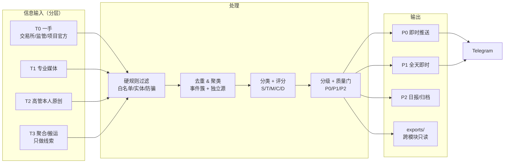
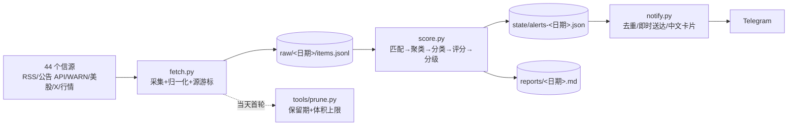
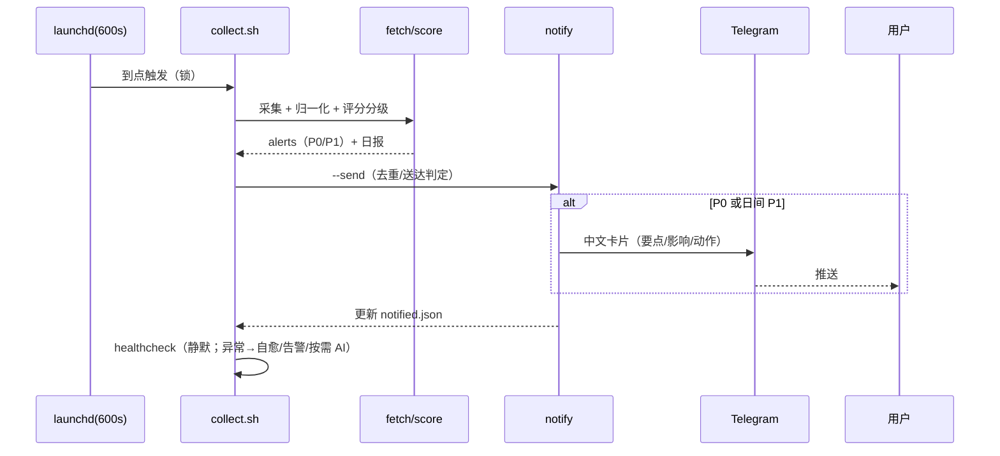

# 业务架构：crypto-news —— 行业信息情报采集/评分/告警

> 需求见 [requirement.md](requirement.md)，实现细节见 [design.md](design.md)；仓库技术架构见 [../architecture.md](../architecture.md)。

## 1. 业务能力图

## 2. 业务数据流

## 3. 告警生命周期

## 4. 与其他模块 / 共享库的关系

| 关系 | 说明 |
|---|---|
| `libs/crypto_core` | `http`、`sources`（rss/announcements/telegram）、`market`（行情参考）、`events`、`dedupe`、`notify`、`store`、`env/config` |
| `crypto-price` | **零 import**；新闻只解释"为什么"，价格只回答"发生了什么"；两者共用 Telegram 凭据与 libs |
| 未来 `crypto-analyst` | 可读 `crypto-news/data/exports/`（事件快照）与 `crypto-price/data/exports/latest.json`，不读 state/raw |
| 调度 | launchd `com.crypto-research.crypto-news`（600s），每轮末内嵌 healthcheck，异常时按需调 `dsh headless` 巡检 |
