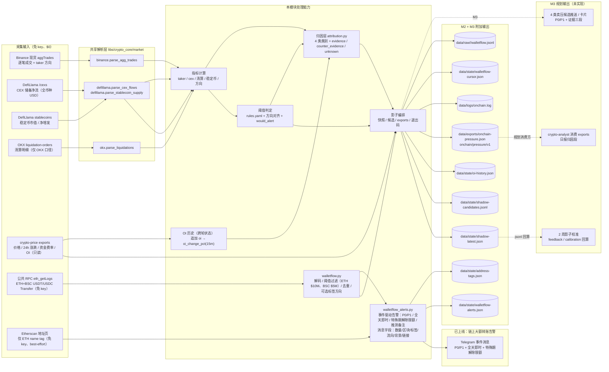
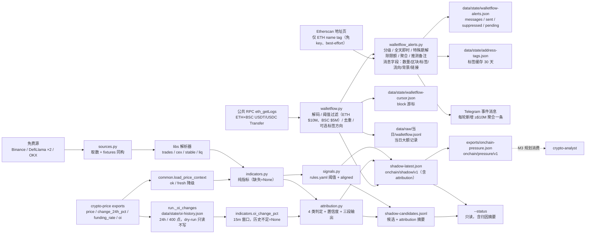
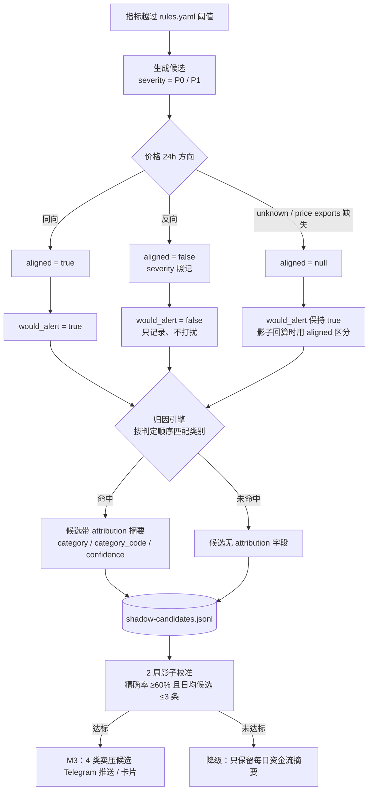
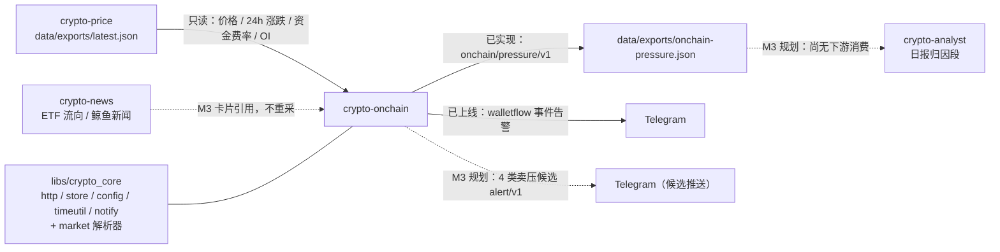

# 业务架构：crypto-onchain —— 交易所/链上"卖压归因"（M2 归因引擎 + walletflow 与事件驱动告警）

> 需求与边界见 [requirement.md](requirement.md)；实现设计见 [design.md](design.md)；模块技术架构见 [technical.md](technical.md)；仓库级技术架构见 [../architecture.md](../architecture.md)（§5.3 模块 × 能力矩阵）。
> 当前阶段 **M2 影子模式（4 类卖压候选）+ M3 附加能力**：四类免费信号采集 + 阈值判定 + **归因引擎（4 类类别 + 三段输出）** + **跨轮 OI 历史** + **`onchain/pressure/v1` 导出**；另有 **walletflow（链上大额转账监控，公共 RPC 免 key）**，其**事件驱动 Telegram 告警已实现（**默认关闭**，改由每日摘要输出链上情报分析）**（仅 P0 推送、全天即时（P1 不推送，仍落盘/进摘要）、常规日限额、特殊期解除日限额、明确标注的“推测”备注；消息含代币数量/区块/地址标签/背景/交易链接，标签可来自内置清单或 Etherscan 地址页公开 name tag，仅 ETH、缓存 30 天、dry-run 不联网）。**4 类卖压候选仍只落盘、不推送**，其推送/卡片/冷却/校准反馈属 M3 规划。

## 1. 业务能力图

业务能力分六层：**采集**（4 个免费源 + `crypto-price` 行情/OI/资金费率背景 + walletflow 的公共 RPC）、**指标**（纯函数、不联网）、**阈值**（`rules.yaml` 分资产分层，产出候选）、**归因**（`attribution.py` 把单信号组合成 4 类卖压类别，资产级 + 市场级）、**状态**（OI 历史跨轮累计）、**影子 + 导出**（只落盘）。M2 已交付"采集 → 指标 → 阈值 → 归因 → 影子 + exports"闭环；**M3 附加能力 walletflow** 另走"公共 RPC → 解码/过滤 → 快照/exports/每日摘要 + 事件驱动告警"支线（**不参与候选/归因**，只回答"发生了什么大额转账"、不回答"地址属于谁"）。其中**链上大额转账告警已上线**（图中实线到 Telegram，仅 P0 推送、全天即时（P1 不推送，仍落盘/进摘要） + 日限额 + 特殊期解除限额）；**4 类卖压候选的 Telegram 推送与校准回算仍是 M3 规划**（虚线），不能当作已交付能力。

## 2. 业务数据流

数据流的关键约定：联网与 `--fixtures` 两种模式返回**同一种结构**，`run.py` 无需分支；解析全部下沉到 `libs/crypto_core/market/`，模块内只做阈值、归因与编排，不复制解析逻辑。任一行情源失败只记录 `errors[]` 并降级，不阻塞其它信号、归因与影子落盘。OI 历史是**主流程唯一的跨轮状态**：每轮把当前 `oi` 追加后计算 15m 变化，历史不足时 `oi_change_15m_pct=null`（归因置信度随之降级，不会硬编一个假变化）。另有一条**独立的 walletflow 支线**：公共 RPC 按链增量扫描 ETH/BSC 的 USDT/USDC Transfer 日志（记录阈值 ETH $10M / BSC $5M、默认排除 mint/burn），游标 `data/state/walletflow-cursor.json` 只在成功时前进，记录进快照 `walletflow` 块、`data/raw/<date>/walletflow.jsonl` 与 exports（只增字段）；随后 `walletflow_alerts.py` 对**本轮新增**的大额转账发事件驱动 Telegram（≥`alerts.min_usd=$10M`；**只有 P0 推送**（`only_p0=true`，P1 记 suppressed、仍落盘/进摘要）、全天即时；常规 ≤10 条/天（特殊期解除）、特殊期解除（仍保留去重与单轮 5 笔）；发送成功才写状态、失败进 pending；同一 tx 多腿只保留 USD 最大一腿；dry-run 只预览）。**2026-11-10 消息增强**：每条聚合行补代币数量（千分位）/区块号/from→to 缩写/地址标签/背景（今日第 N 笔与占比、近 7 天频次、同 tx 多腿提示）/Etherscan·BscScan 交易链接；地址标签渲染时优先内置 `walletflow.labels`，其余由 `walletflow_alerts.enrich_tags` 抓 Etherscan 地址页公开 name tag（**仅 ETH**、免 key、页面 HTML、缓存 `data/state/address-tags.json` 30 天、失败静默），**dry-run 不联网**、只显示内置标签。这条支线不参与候选/归因，RPC 或告警失败只记 `walletflow.error`/`walletflow.alerts.error`，不影响主数据流与 rc。

## 3. 归因层与三段输出

归因层（[scripts/attribution.py](../../crypto-onchain/scripts/attribution.py)）把"单信号候选"升级为"可检验的类别结论"，判定的优先级固定（先匹配先生效）：

| 顺序 | category_code | 触发条件（全部满足） | 置信度 |
|---|---|---|---|
| 1 | `long_liquidation` | 价格下跌 + 15m 清算额 ≥ 资产 P1 + 多头占比 ≥ 0.6 | OI ≤ −2% → `high`；OI > 0 → `low`；其余/未知 → `medium` |
| 2 | `short_add` | 价格下跌 + 5m 主动卖占比 ≥ 0.58 + OI 未显著下降（未知也满足） | OI ≥ 2% 且资金费率 ≤ 0 → `high`；其余 → `medium` |
| 3 | `capital_exit` | 价格下跌 + CEX 24h 净流 ≤ −50bps TVL + 稳定币 24h 净赎回 ≤ −5 亿美元 | `medium`（市场级 |CEX bps| ≥ 150 时 `high`） |
| 4 | `deleverage` | 价格下跌 + OI ≤ −2% + 无强平/主动卖/资金撤离证据 | `medium` |

每条结论强制包含三段：`evidence`（证据数值与窗口）、`counter_evidence`（什么情况说明推断错）、`unknown`（"无法判断卖方身份…"），并带 `category` / `category_code` / `confidence` / `basis`。**只回答是"哪一类仓位/哪一类资金"在卖，不回答"谁"**——归因层没有任何身份字段，测试用"某机构/某巨鲸/某基金/某个人"黑名单断言。

## 4. 候选信号生命周期

候选生命周期刻意把"**是否达到阈值**"与"**是否该打扰**"分开：阈值决定 `severity`（P0/P1），方向门控决定 `would_alert`。方向相反时候选仍写盘、`severity` 仍保留，只是 `would_alert=false`；方向未知时 `aligned=null`，不被当作反向处理。归因是**附加信息**：命中类别时写进候选与快照，未命中（例如价格未下跌）时保持 `null`，不影响候选本身的产生。2 周校准（`shadow.target_precision=0.60`、`shadow.target_daily_candidates=3`）达标才进入 **4 类卖压候选的 M3 推送**；当前仍**没有**自动回算脚本，需离线分析 jsonl。**walletflow 的链上大额转账告警不走这条生命周期**，它由 `walletflow_alerts.py` 独立判定（见 §1 与 [design.md](design.md) §9.7）。

## 5. 与其它模块 / 共享库的关系

| 对象 | 关系 | 说明 |
|---|---|---|
| `crypto-price` | **只读 exports** | 读 `../crypto-price/data/exports/latest.json` 的价格/24h 涨跌/24h 成交量，以及 M2 新增的 `funding_rate` / `oi`（`funding_ts` / `oi_ts` 当前未读取）；超 900 秒标记 `fresh=false`；缺失时回退逐笔价、方向 `unknown`。不写对方 `data/`、不 import 对方代码 |
| `crypto-news` | **不重采** | ETF 流向与鲸鱼新闻留在 news；M3 卡片只引用、不重新采集；M2 尚未接入引用 |
| `crypto-analyst` | **未来 exports 消费方（未接入）** | M2 已写 `data/exports/onchain-pressure.json`（`onchain/pressure/v1`，只增字段）；**目前没有任何下游消费方**，契约先落盘待接入 |
| `libs/crypto_core` | 复用共享能力 | `http`、`store`、`config`、`timeutil`、`env`、`paths`、`notify`；行情解析 `market.binance/defillama/okx` |
| Telegram（walletflow 告警） | **已上线** | `walletflow_alerts.py` + `digest.py` 用 `crypto_core.notify` 发消息；walletflow 告警是**事件驱动**（每轮新增 ≥$10M、仅 P0 推送、全天即时（P1 不推送，仍落盘/进摘要）、常规日限额可扩容、特殊期解除日限额），消息含代币数量/区块/地址标签/方向/背景/交易链接；`--fixtures` 不发、`--dry-run` 只预览；数据层不做地址归属 |
| Etherscan 地址页（仅告警补标签） | **免 key 页面抓取（非官方 API）** | 仅告警发送时对本轮地址抓 `https://etherscan.io/address/<addr>` 的公开 name tag；仅 ETH；缓存 `data/state/address-tags.json` 30 天；失败静默；`--dry-run` 不联网。标签只用于展示、不写入数据记录、不做实体断言 |
| Telegram / `alert/v1`（4 类卖压候选） | **M3 规划** | 4 类候选仍不推送；`delivery.*` 只是配置骨架，代码不读取 |
| launchd / `collect.sh` | 影子采集 + 链上告警 | `com.crypto-research.crypto-onchain` 已安装（2026-11-09），按 `poll_seconds=300` 每 5 分钟跑 `collect.sh`：单实例锁 → `run.sh`（采集 + 归因 + walletflow + 事件告警）→ healthcheck（异常才告警/自愈）→ 每日首轮 prune；4 类卖压候选仍只落盘 |

模块间保持**零 import**：与 `crypto-price` 的唯一耦合是只读 JSON 契约，与 `crypto-news`/`crypto-analyst` 的耦合是未来产物契约，全部通过 `data/exports/` 与 docs 约定完成。阈值、路由、信号组合全部留在本模块 `config/`，不进 `libs`（仓库约定 §6）。

## 6. 一句话总结

crypto-onchain 在 M2 是"**带归因的影子观察者**"：把四处免费数据（Binance 逐笔、DefiLlama 交易所储备、OKX 清算、DefiLlama 稳定币）加上 `crypto-price` 的资金费率/OI，换算成四类卖压类别与置信度，按 `rules.yaml` 标注"本会触发什么级别"，并把归因结论、OI 历史与 `onchain/pressure/v1` 契约一起落盘；**只回答类别、不回答谁**。M3 附加能力 **walletflow** 再补一条独立观测线：公共 RPC 免费看 USDT/USDC 的大额转账（ETH 记录 ≥$10M、BSC ≥$5M，默认排除 mint/burn），并已上线**事件驱动 Telegram 告警**（每轮新增 ≥$10M 发一条聚合消息，仅 P0 推送、全天即时（P1 不推送，仍落盘/进摘要）、常规日限额可扩容、特殊期解除日限额；方向 `unknown` 可带**明确标注的“推测”**备注）。它**只回答"链上发生了什么大额转账"，不回答"地址属于谁"**。**2026-11-10 起告警消息补全**：每条聚合行展示代币数量（千分位）/区块/from→to（缩写）/地址标签/背景/交易链接，地址标签来自内置清单或 Etherscan 地址页公开 name tag（仅 ETH、缓存 30 天、失败忽略），仍只作展示、**不做实体断言**。**4 类卖压候选的 Telegram 推送、卡片、去重冷却/静默/日限额、feedback 与校准回算仍属 M3 规划**，等 2 周影子校准达标之后。
