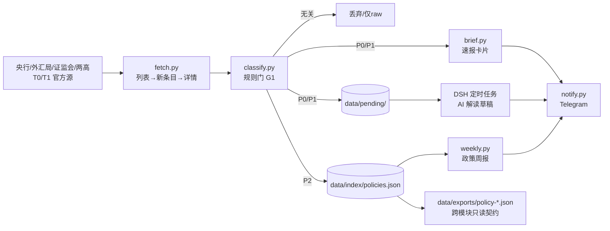

# 业务架构：crypto-policy

> 需求见 [requirement.md](requirement.md)｜设计见 [design.md](design.md)｜技术架构见 [technical.md](technical.md)

## 1. 业务能力

| 能力 | 说明 |
|---|---|
| 政策雷达 | 盯 T0/T1 权威源，发现「新文件/新案例」 |
| 规则门 | 去重、分类、分级，把噪声挡在 AI 之前 |
| 法规库 | 按文号建索引，维护 effective/pending/repealed 与替代关系 |
| 速报 | P0 立即、P1 当日汇总，只讲事实 |
| 解读草稿 | 对 P0/P1 生成「AI 草稿」，人工复核 |
| 周报（手动） | 需要时复盘法规库变化；不排期、不固定推送 |

## 2. 业务数据流



## 3. 关键流程

1. **发现**：每 6 小时拉列表页，URL 规范化 + 已见集合去重；首次运行只建基线。
2. **抓详情**：优先抓标题命中主题的条目（详情预算有限），正文哈希用于版本判断。
3. **规则门**：类型/文号/施行日/主题/等级/废止关系；标题命中才进库，P0 允许正文命中。
4. **入库**：同一文号更新覆盖；新文件「废止 X 号」→ 旧条目 `repealed`。
5. **推送**：P0 单条立即、P1 汇总；**24/7 即时发送（不设静默时段）**；发送成功才写 `notified.json`。
6. **解读**：只写 `pending/`；DSH 任务消费并推送，标注 AI 草稿。
7. **周报（手动）**：需要时汇总法规库变化；不排期、不固定推送，无变化默认静默。

## 4. 模块关系

```
crypto-policy ──只读──> libs/crypto_core
      │                 ├─ http / store / text / timeutil
      │                 └─ notify（Telegram）
      │
      ├─ 输出 data/exports/policy-<date>.json（供 crypto-analyst / crypto-analyst 只读）
      └─ 输出 data/pending/（供 DSH 解读任务消费）

crypto-news：新闻流（发现层），本模块不依赖；未来可用其 exports 做线索交叉验证。
```

边界：`crypto-policy` 不 import 其他模块，不读其他模块的 `raw/state/reports`；
其他模块只允许读本模块的 `data/exports/`。
