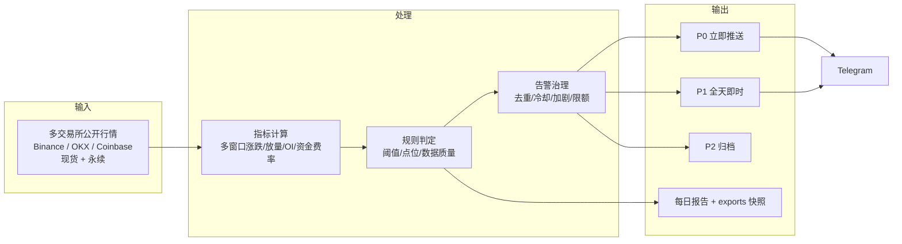
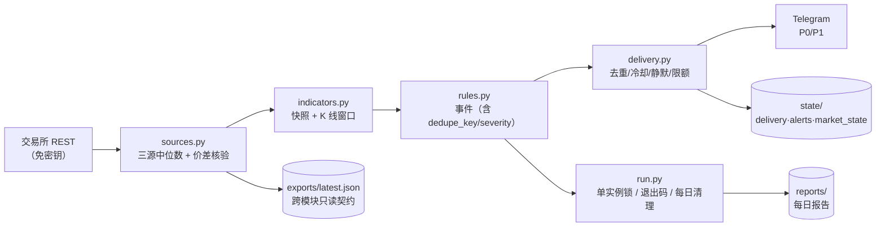
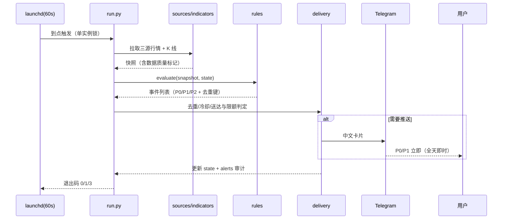

# 业务架构：crypto-price —— 主流币价格/衍生品异动实时告警

> 需求见 [requirement.md](requirement.md)，实现细节见 [design.md](design.md)；仓库技术架构见 [../architecture.md](../architecture.md)。

## 1. 业务能力图

## 2. 业务数据流

## 3. 告警生命周期

## 4. 与其他模块 / 共享库的关系

| 关系 | 说明 |
|---|---|
| `libs/crypto_core` | `http`、`market.binance/okx/coinbase`、`events`、`notify`、`store`、`timeutil`、`env/config` |
| `crypto-news` | **零 import**；两者只共用 libs 与 Telegram 凭据；价格只回答"发生了什么"，不解释"为什么"（新闻解释由 crypto-news 负责） |
| 未来 `crypto-analyst` | 只读 `crypto-price/data/exports/latest.json`（`price/snapshot/v1`）与 `crypto-news/data/exports/`，不读对方 state/raw |
| 调度 | launchd `com.crypto-research.crypto-price`（`StartInterval=60`） |
