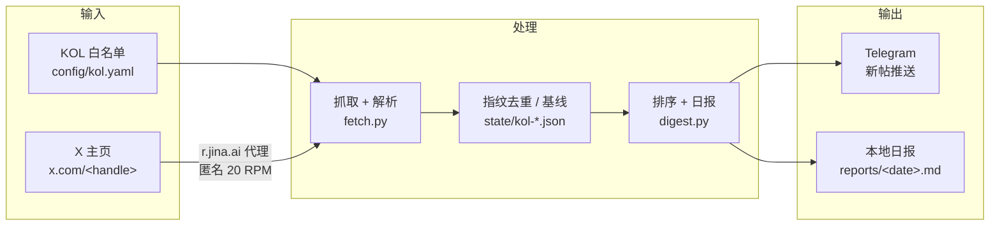
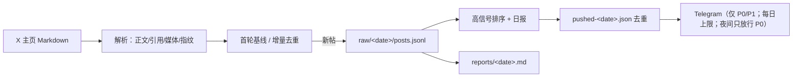
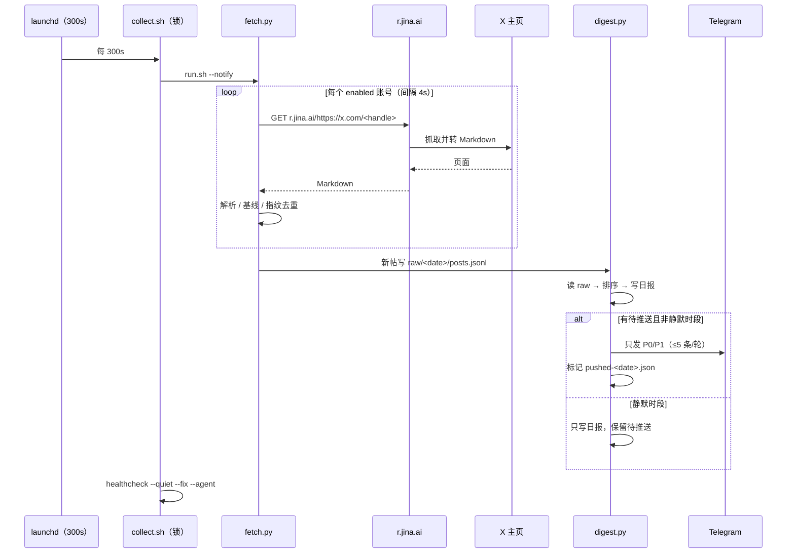
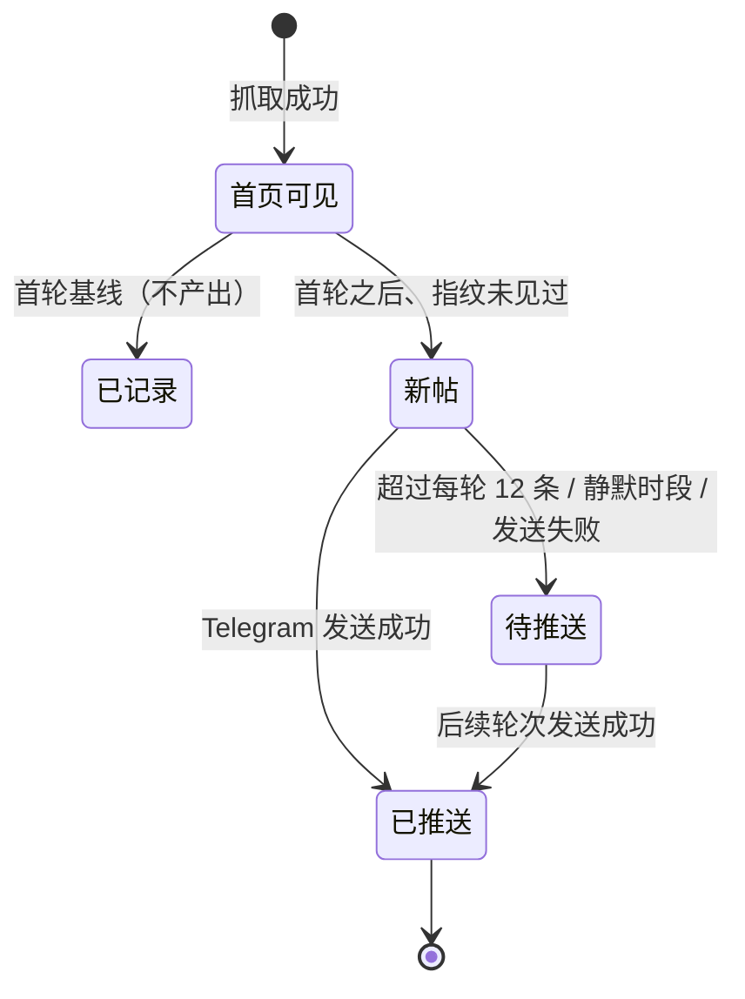

# 业务架构：crypto-x-kol —— 关注的 KOL 的 X 推文监控

> 需求见 [requirement.md](requirement.md)，实现细节见 [design.md](design.md)。
> 仓库技术架构（分层/调度）见 [../architecture.md](../architecture.md)。

## 1. 业务能力图

## 2. 业务数据流

## 3. 关键流程 / 生命周期

## 4. 与其他模块 / 共享库的关系

| 关系 | 说明 |
|---|---|
| `libs/crypto_core` | `paths/env/config/store/text/timeutil`、`http.get_text`、`notify.check_credentials/send_message`、`timeutil.in_quiet_hours` |
| `crypto-news` | 零 import；T2「高管发声」仍由 crypto-news 负责，本模块只做 KOL 推文监控；共用根 `.env` 的 Telegram 凭据 |
| `crypto-analyst` | 当前不消费本模块数据；如后续要进周报，由本模块提供 `data/exports/` 契约 |
| 调度 | launchd Label `com.crypto-research.crypto-x-kol`，`StartInterval` 取 `app.yaml` 的 `poll_seconds` |
| 健康检查 | `tools/healthcheck.py --module crypto-x-kol`：解析 `collect.log` 的 start/done 与「采集完成」行；失败可自愈/告警 |
| 数据维护 | `tools/prune.py --module crypto-x-kol`：raw 90d / reports 365d / logs 30d / data 500MB 上限 |

## 5. 状态机（单条推文）

